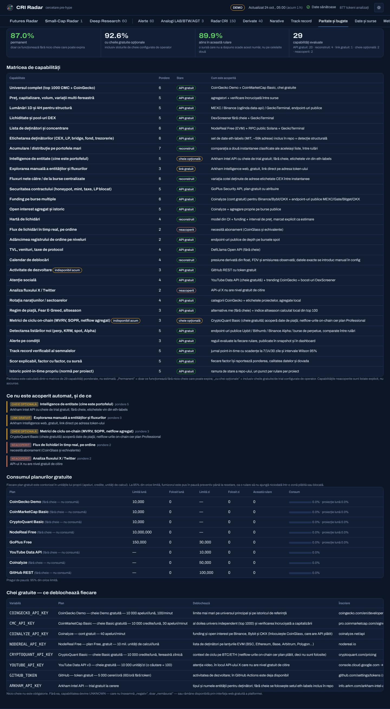
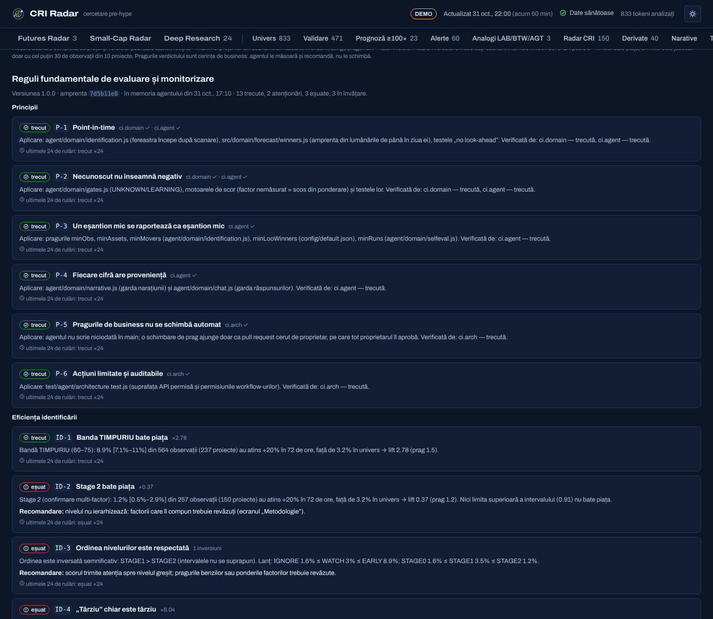
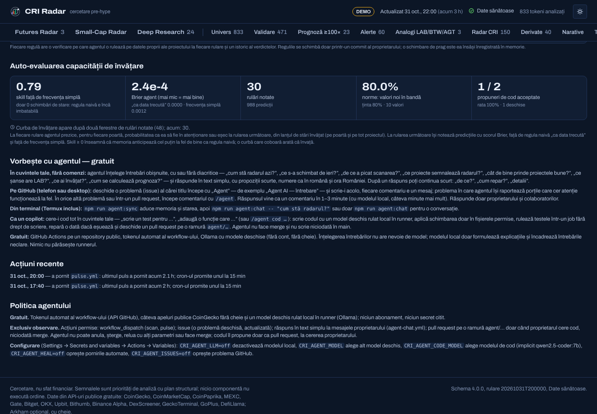
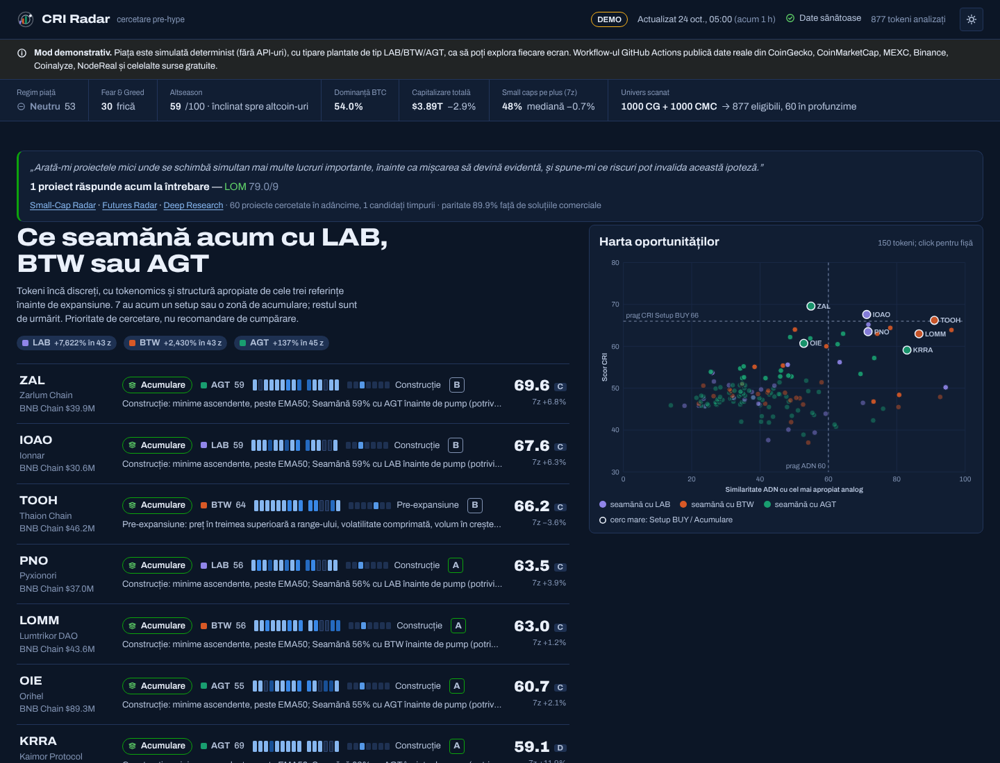
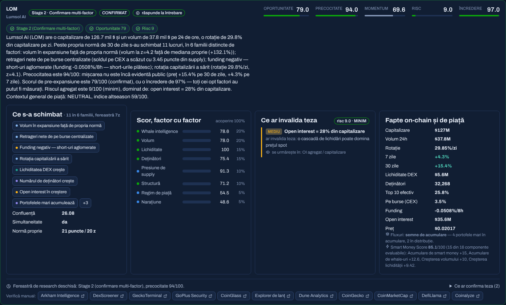
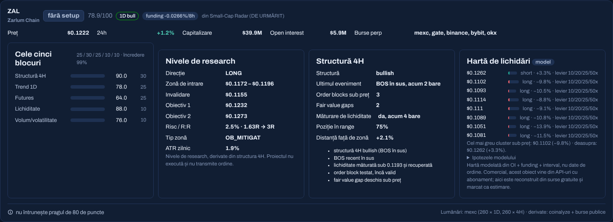
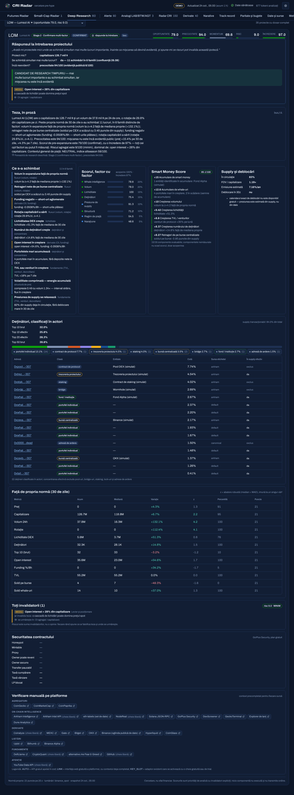
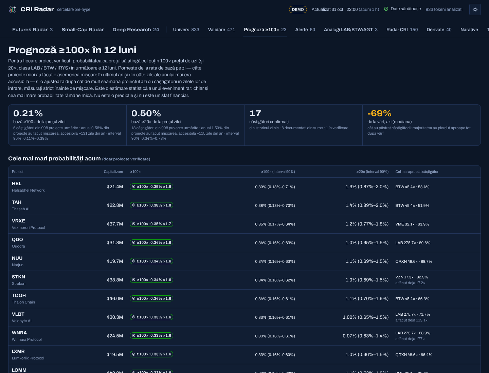
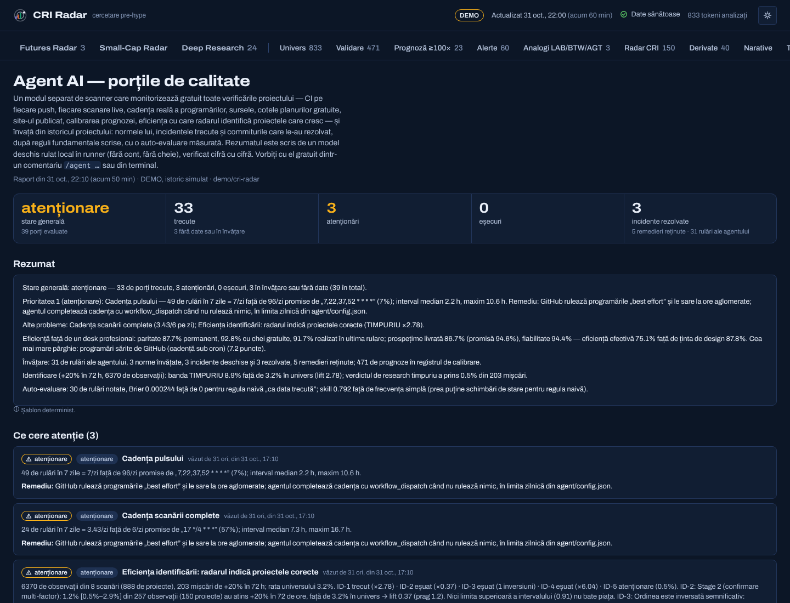
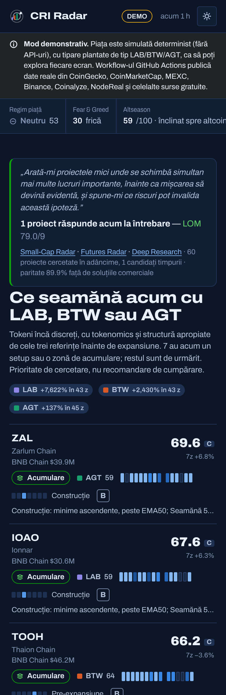

# CRI Radar

**Crypto Research Intelligence** — un motor de cercetare care scanează top 1000 CoinMarketCap și
CoinGecko plus toate tokenurile Binance Alpha și Gate Alpha, cercetează în profunzime **fiecare**
proiect eligibil (până la 1000) și răspunde la o singură întrebare, formulată cuvânt cu cuvânt:

> „Arată-mi proiectele mici unde se schimbă simultan mai multe lucruri importante, înainte ca
> mișcarea să devină evidentă, și spune-mi ce riscuri pot invalida această ipoteză.”

Node.js, arhitectură hexagonală, **zero dependențe la rulare**, **niciun abonament de niciun fel**.
Rulează pe GitHub Actions și publică un dashboard static pe GitHub Pages.

Pe lângă răspunsul la întrebare, fiecare proiect verificat primește o **prognoză ≥100× în 12 luni**,
învățată din câștigătorii ultimului an (LAB, BTW, IRYS, AKEDO, pippin…), iar un **agent AI separat**
monitorizează gratuit toate porțile de calitate ale proiectului, măsoară cât de bine identifică radarul
proiectele care cresc, judecă prognoza după **reguli fundamentale scrise în memoria lui**, își
**notează singur predicțiile** (auto-evaluare) și **vorbește cu proprietarul în limbaj natural, în text
simplu** — „cum stă radarul?”, „de ce a picat scanarea?”, „ce s-a schimbat de ieri?” — gratuit, pe GitHub
sau din terminal (Termux inclus), cu diagnoze și, la cerere, cu **cod propus ca pull request**, testat
înainte.

Toate cerințele de business, cu criteriul de acceptare și locul în care fiecare este verificată, sunt
în secțiunea [Cerințele de business](#cerințele-de-business).

Este un proiect **exclusiv de cercetare**. Nicio componentă nu plasează și nu transmite ordine — un
test de arhitectură respinge automat orice endpoint de execuție sau de retragere.

---

## Ce face, concret

Întrebarea are patru părți, iar fiecare are un motor dedicat.

### „proiectele mici”
Proiecte mici și medii: capitalizare între **1 și 300 milioane $**, volum de minimum
**500 000 $/zi**. Universul este construit din două surse independente (CoinGecko și
CoinMarketCap, cu CoinPaprika ca plasă de siguranță), fuzionate pe contract și pe nume, nu pe simbol
— ca să nu ajungă doi omonimi în același rând; același simbol pe același lanț, dar la alt contract,
este alt token. Stablecoin-urile (recunoscute și după comportament: un token ancorat la 1 $, 1 € sau
la altă monedă, oricum s-ar numi), activele wrapped/staked și acțiunile tokenizate sunt excluse
explicit, iar fiecare excludere este numărată și publicată.

### Poarta de validitate: cine are voie în listele CRI
Înainte de a fi clasat, fiecare proiect eligibil trece **cinci verificări obligatorii**. Doar cele
care le trec pe toate apar în Small-Cap Radar, Radar CRI, Deep Research, alerte și track record:

| Verificare | Ce citește | Respinge când |
|---|---|---|
| Capitalizare mică sau medie, confirmată | CoinGecko, CoinMarketCap, CoinPaprika, Binance Alpha | peste 300 M$ sau sub 1 M$; capitalizare raportată doar de Gate Alpha; stablecoin, wrapped, tokenizat |
| Proiect real, identificat | agregatori, Binance Alpha, GoPlus, site și conturi sociale | niciun agregator și nici Binance Alpha; GoPlus: imitație a altui token, airdrop scam |
| Listat pe burse | spot Binance, OKX, Gate, Bitget, MEXC, Upbit, Bithumb; perpetue; Binance Alpha; lista de burse GoPlus | nicio piață centralizată care tranzacționează (≥ 10 000 $ în 24 h) — Gate Alpha singur nu ajunge |
| Contract fără capcane | GoPlus Token Security (EVM și Solana), GeckoTerminal | honeypot, vânzare blocată, taxă > 10 %, owner care modifică solduri, autodistrugere, creator cu honeypot-uri; owner ascuns, cod neverificat, înghețare — doar dacă nicio bursă de nivel 1–2 nu îl listează |
| Lichiditate reală | burse centralizate, DexScreener, Binance Alpha | fără piață spot centralizată și pool DEX sub 50 000 $ |

Distribuția deținătorilor și vechimea sunt **informative**: produc atenționări, nu resping. Regula
proiectului se aplică și aici — **„necunoscut” nu înseamnă „respins”**: un proiect al cărui contract
nu a fost încă scanat stă „în verificare” până îl aduce rotația GoPlus, fără să fie etichetat; doar o
dovadă respinge. Ecranul **Validare** publică regulile, numerele și fiecare proiect oprit, cu motivul;
în **Univers** filtrul „Validare” arată implicit doar proiectele verificate. Pragurile sunt în
`config/default.json` → `validity`.

**Binance Alpha intră în univers în întregime**, nu doar ca etichetă. LAB, BTW și AGT erau toate
tokenuri Alpha, iar LAB avea 12 M$ capitalizare înainte de mișcare — sub pragul de ~15 M$ al top
1000 CoinGecko. Un token Alpha deja prezent în top 1000 este doar îmbogățit; unul din afara lui
devine proiect propriu, cu identitatea CoinGecko când aceasta îi cunoaște contractul. Lista Alpha
(publică, fără cheie) aduce gratuit, pentru fiecare token, deținătorii și lichiditatea: două familii
de factori măsurabile față de propria normă la fiecare rulare, fără niciun apel în plus. Pe un token
Alpha cu rotație de peste 100 % pe zi, invalidatorul `ALPHA_VOLUME` amintește că o parte din volum
poate veni din farmingul punctelor Alpha.

**Programele Alpha ale tuturor burselor**, verificate unul câte unul (octombrie 2026):

| Bursă | Program | Listă publică prin API | Cum intră în radar |
|---|---|---|---|
| Binance | Binance Alpha | da — token list, exchange info, klines (developers.binance.com) | univers + holderi + lichiditate + lumânări 1D/4H + intrări noi |
| Gate | Gate Alpha | da — API v4 `/alpha/currencies` și `/alpha/tickers`, fără cheie | univers + preț, volum, capitalizare + intrări noi (`NEW_GATE_ALPHA`) |
| KuCoin | KuCoin Alpha | nu (doar anunțuri) | prin agregatori, DEX și listele Binance/Gate |
| Bybit | Bybit Alpha | nu | la fel |
| Bitget | Bitget Onchain | nu (API-ul Bitget Wallet cere parteneriat) | la fel |
| MEXC | zona Alpha / DEX+ | nu | la fel |

Un token ales de **mai multe** programe Alpha poartă eticheta fiecăruia, iar intrarea într-un program
(Binance Alpha, Gate Alpha), o listare coreeană sau trecerea Alpha → Binance spot contează ca
schimbare în familia „listări și acces”.

### Orizontul: întregul univers, nu o listă scurtă
Fiecare proiect eligibil — până la **1000** — este cercetat în profunzime la fiecare rulare:
lumânări 1D/4H (Binance, MEXC, Binance Alpha) și lichiditate DEX pentru toate. Sursele gratuite care
răspund doar câteva zeci de apeluri pe rulare (GoPlus, detaliile CoinGecko, GeckoTerminal, GitHub,
YouTube) **se rotesc** prin univers: prioritatea rulării întâi, apoi proiectele măsurate cel mai demult.
Faptele statice (securitatea contractului, categoriile, repository-ul) se păstrează între rulări cu
data citirii; măsurătorile (deținători, commit-uri, mențiuni) nu sunt niciodată copiate în istoric a
doua oară — un proiect nemăsurat în rularea curentă raportează „necunoscut”, nu cifra de ieri.
Futures Radar evaluează **fiecare piață perpetuă** din univers. Dashboard-ul arată vârful fiecărui
clasament cu toate dovezile, iar ecranul **Univers** (`data/universe.json`) arată toate rândurile.

Pe adresele partajate ale runner-elor GitHub, planurile gratuite răspund des „prea multe cereri”.
O limită de rată nu oprește furnizorul: încetinește toată coada lui (pauza cerută de server, apoi un
ritm mai rar, care revine treptat după răspunsuri reușite), iar circuitul se deschide doar după
câteva cereri la rând refuzate chiar și după pauză. Sursele lente se opresc cu 4 minute înainte de
termenul rulării, ca Futures Radar și snapshot-ul să aibă timpul lor.

Citirile care depind de cine le-a măsurat — deținători, lichiditate, concentrare — își păstrează
sursa, iar norma compară doar citiri din aceeași sursă: o rulare în care a răspuns GoPlus și una în
care a răspuns GeckoTerminal nu produc o „creștere a deținătorilor” falsă.

### „se schimbă simultan mai multe lucruri importante”
Fiecare rulare completă salvează un punct per proiect pe o ramură de stare. Din acel istoric se
construiește **norma proprie a proiectului** (median + MAD pe 30 de zile), iar o schimbare contează
doar dacă depășește acea normă — nu un prag universal. Un token cu volum mereu erratic nu primește un
semnal pentru același salt care ar fi remarcabil pe unul liniștit.

Simultaneitatea cere **lățime**: minimum 3 schimbări importante în minimum 2 **familii distincte** de
factori (fluxuri, deținători, lichiditate, derivate, fundamente, atenție, listări, structură). Cinci
semnale din aceeași familie sunt un singur lucru care se întâmplă, nu cinci.

### „înainte ca mișcarea să devină evidentă”
**Precocitatea** este raportată separat de momentum și nu este niciodată contopită cu el. Cazul LAB
din soluția tehnică este exact motivul: un proiect deja +400 % are momentum 98 și precocitate 35 —
excelent și prea târziu. Evidența publică se măsoară din preț, poziția în interval, trending,
boost-uri plătite și funding aglomerat.

### „ce riscuri pot invalida această ipoteză”
Riscul nu este o notă, ci o **listă de invalidatori numiți**. Fiecare rând spune ce anume ar falsifica
teza și unde se urmărește: honeypot, owner care poate relua controlul, taxă de vânzare, LP neblocat,
deblocare în 30 de zile, float mic, concentrare efectivă, lichiditate subțire, funding periculos,
trezoreria care trimite către burse exact în timpul semnalului. Un invalidator critic duce singur
scorul de risc în banda critică, fiindcă exact asta înseamnă „critic”.

### Verdictul
```
Early Research Candidate = Stage 1–2  ȘI  oportunitate > 75  ȘI  risc < 60
```
Definiția din soluția tehnică, fără condiții adăugate. Un proiect „răspunde la întrebare” când trece
acest test **și** are schimbări simultane în cel puțin două familii.

### Prognoza ≥100× în 12 luni, învățată din câștigătorii ultimului an
Fiecare proiect verificat primește probabilitatea unei creșteri de cel puțin **100×** (și de **20×**,
clasa LAB / BTW / IRYS) în următoarele 12 luni: pe card, în dosar, în fișa proiectului, în Univers
(coloana „≥100×”) și în ecranul **Prognoză ≥100×**. Este o estimare statistică a unui eveniment rar,
nu o predicție: chiar și cea mai mare probabilitate rămâne de ordinul procentelor. Evenimentul este
numit exact, fiindcă de el depinde cifra:

> **prețul atinge cel puțin N× prețul din ziua citirii, în următoarele 365 de zile.**

1. **Lista de învățare** — proiectele care au crescut de cel puțin 15× în ultimele 365 de zile, din
   două surse gratuite: semințe documentate cu surse publice (`config/winners.json`) și candidații
   semnalați automat, la fiecare scanare, de minimele și maximele istorice ale întregii piețe
   (aceeași listă CoinGecko pe care scanarea o citește oricum — zero apeluri în plus). Fiecare intrare
   se confirmă din istoricul zilnic CoinGecko (câteva pe rulare, în bugetul gratuit), pe mediana a
   trei zile, cu minimul acceptat doar unde capitalizarea ≥ 1 M$ și volumul ≥ 25 000 $ — un tick
   izolat pe o pereche goală nu poate inventa o mișcare de 1000×.
2. **Zilele din care mișcarea era accesibilă** — pentru fiecare câștigător confirmat se numără zilele
   lichide din care prețul a mai atins N× prețul acelei zile (LAB: 175 de zile pentru ≥100×). O rată
   numărată „de la minim la vârf” ar supraevalua probabilitatea pe care o vede cineva care citește
   radarul într-o zi oarecare.
3. **Rata de bază pe zi** — câștigătorii împărțiți la proiectele mici urmărite în fereastră (posterior
   Beta cu o estimare prudentă la pornire: 0,5 % pe an, cântărită ca 200 de proiecte; interval Wilson
   90 %), înmulțiți cu partea din an din care mișcarea era accesibilă. Pe datele demo: ≥100× anual
   0,58 % × 131 de zile / 365 ≈ **0,21 % pentru o zi oarecare**.
4. **Ajustarea după amprentă, fără date din viitor** — fiecare câștigător contribuie cu până la patru
   amprente, din zilele lui accesibile (minimul inclus), fiecare măsurată doar din lumânările de până în
   ziua ei. Cât de dens stau aceste amprente în jurul proiectului față de cât de dens stă universul de
   azi (nucleu gaussian), tras spre 1 cât timp câștigătorii sunt puțini și limitat la ×25:
   `p = p₀·LR / (p₀·LR + 1 − p₀)`.
5. **Validarea în afara eșantionului** — fiecare câștigător este scos pe rând din învățare și clasat
   printre proiectele de azi de modelul învățat fără el. Pe datele demo, 61,5 % dintre cei 13
   câștigători ≥20× ies în top 20 % (aleator: 20 %). Când amprenta nu bate întâmplarea (sub 20 %, cu
   cel puțin 8 câștigători), motorul **oprește singur ajustarea** și publică rata de bază pe zi.

Semințele documentate (31 octombrie 2026, fiecare cu sursele ei în `config/winners.json`):

| Proiect | Lanț | Minim → vârf | Multiplu | Azi față de vârf |
|---|---|---|---|---|
| AKEDO (AKE) | BNB Chain | 0,000174 $ (iul 2026) → 0,1401 $ (20 sep 2026) | ~805× | −82 % |
| Bitway (BTW) | BNB Chain | 0,007687 $ (2 mar 2026) → 2,75 $ (14 oct 2026) | ~358× | −54 % |
| pippin (PIPPIN) | Solana | 0,00257 $ (oct 2025) → 0,8973 $ (26 feb 2026) | ~349× | −98 % |
| LAB | BNB Chain | ~0,10 $ (dec 2025) → 27,48 $ (iun 2026) | ~275× | −99,8 % |
| Alaya (AGT) | BNB Chain | 0,00161 $ (oct 2025) → 0,1099 $ (18 oct 2026) | ~68× | −32 % |
| Venice (VVV) | Base | 0,9172 $ (nov 2025) → 34,47 $ (sep 2026) | ~38× | −38 % |
| Irys (IRYS) | — | 0,0118 $ (oct 2026) → 0,2648 $ (23 oct 2026) | ~22× | −92 % |
| Audiera (BEAT) | BNB Chain | 0,59 $ (mai 2026) → 11,10 $ (12 iun 2026) | ~19× | −99 % |
| River (RIVER) | BNB Chain | ~5 $ (dec 2025) → 87,54 $ (26 ian 2026) | ~18× | −99 % |
| DeAgentAI (AIA) | BNB Chain | vârf 25,52 $ (7 nov 2025), minim nedocumentat | — | — |

Excluse, cu motivul: **YZY** (minimul raportat pare un tick izolat), **DOYR** (+5 891 % de la ~80 mii $
capitalizare — sub pragul universului, invizibil înainte de mișcare), **MYX, COAI, 币安人生** (mișcarea
principală s-a încheiat înainte de fereastra de 12 luni).

Ce spune lista, onest: **majoritatea câștigătorilor și-au pierdut aproape tot câștigul** după vârf
(mediana de azi față de vârf este în jur de −90 %), agregatorii păstrează mai ales supraviețuitorii
(deci rata de bază este o limită superioară), iar puterea de separare a amprentei se măsoară pe datele
de învățare (optimistă). De aceea agentul AI înregistrează săptămânal fiecare prognoză și o compară cu
ce s-a întâmplat efectiv — calibrarea se măsoară în timp, nu se presupune.

---

## Cerințele de business

Ce trebuie să facă proiectul și cum, în cuvintele proprietarului, fiecare cu **criteriul de acceptare**
și **locul în care este verificată** — o poartă de calitate (vezi [Porțile de calitate](#porțile-de-calitate)),
o regulă fundamentală a agentului (`agent/knowledge/rules.json`) sau un test. O cerință fără verificare
nu este listată ca îndeplinită.

### A. Produsul

1. **Întrebarea, cuvânt cu cuvânt.** „Arată-mi proiectele mici unde se schimbă simultan mai multe
   lucruri importante, înainte ca mișcarea să devină evidentă, și spune-mi ce riscuri pot invalida
   această ipoteză.”
   *Acceptare:* fiecare din cele patru părți are un motor dedicat (mic · simultan · înainte · riscuri),
   iar Small-Cap Radar arată, pe fiecare card, testul în trei părți și partea care a picat.
   *Verificat:* testele de domeniu și end-to-end (`ci.domain`, `ci.application`).
2. **Universul.** Top 1000 CoinMarketCap și CoinGecko plus toate tokenurile Binance Alpha și Gate
   Alpha; **fiecare** proiect eligibil cercetat în profunzime (până la 1000), nu o listă scurtă.
   *Acceptare:* universul complet la fiecare scanare, fără prăbușiri față de normă; fiecare proiect
   cercetat apare în Univers. *Verificat:* `scan.universe`, `scan.sources`.
3. **„Proiecte mici”.** Capitalizare 1–300 M$, volum ≥ 500 000 $/zi; fuziune pe contract și nume, nu pe
   simbol. *Verificat:* `config/default.json` și testele universului.
4. **Verdictul.** `Early Research Candidate = Stage 1–2 ȘI oportunitate > 75 ȘI risc < 60`; un proiect
   „răspunde la întrebare” când trece testul și are schimbări simultane în cel puțin două familii.
   Benzile de oportunitate: IGNORĂ < 40 · DE URMĂRIT 40–60 · TIMPURIU 60–75 · CONFIRMAT 75–90 ·
   POTENȚIAL RIDICAT ≥ 90. *Acceptare:* pragurile nu se schimbă automat — agentul le măsoară și
   recomandă, cu dovezi, iar decizia este a proprietarului (regula P-5). *Verificat:* testele motorului
   de stadiu și verdict; regula ID-5 măsoară câte mișcări prinde verdictul.
5. **Riscurile ca invalidatori.** Fiecare ipoteză vine cu lista explicită a ce o poate invalida.
   *Verificat:* motorul de invalidatori și testele lui; ecranul Deep Research.
6. **Poarta de validitate.** În listele CRI ajung doar proiecte verificate (cinci verificări
   obligatorii); un proiect respins apare în ecranul Validare cu motivul, nu ascuns.
   *Verificat:* `scan.validity`.
7. **Prognoza ≥100× / ≥20× în 12 luni**, pentru fiecare proiect verificat, învățată din câștigătorii
   ultimului an (LAB, BTW, IRYS, AKEDO, pippin…), ca probabilitate cu interval și bază, pentru
   evenimentul „prețul atinge N× prețul din ziua citirii”. *Acceptare:* eveniment declarat, rată pe zi,
   fără date din viitor, rată anuală plauzibilă, validare în afara eșantionului, calibrare în timp.
   *Verificat:* regulile FC-1…FC-7, porțile `scan.forecast` și `model.calibration`.
8. **Identificarea corectă.** Proiectele semnalate trebuie să crească mai des decât piața — măsurat
   înainte, pe istoricul propriu al radarului, nu presupus. *Acceptare:* banda TIMPURIU cu lift ≥ 1,5 la
   +20 % în 72 h; Stage 2 cu lift ≥ 1,2; ratele cresc odată cu nivelul; stadiul „târziu” chiar este
   târziu; verdictul prinde cel puțin 5 % din mișcări. *Verificat:* regulile ID-1…ID-5, poarta
   `model.identification` (rezultatele live: [Eficiența identificării](#eficiența-identificării--măsurată-pe-istoricul-radarului)).
9. **Futures Radar și Deep Research.** Cinci blocuri ponderate cu note A++…B și filtre dure afișate;
   un proiect pe un singur ecran, cu deținătorii clasificați în actori și concentrarea pe supply-ul
   efectiv. *Verificat:* testele de domeniu `futures/` și `onchain/`, testele de interfață.
10. **Dashboard-ul.** Static, pe GitHub Pages, în limba română, mobile-first (fiecare ecran la 390 px
    fără derulare orizontală), fiecare cifră cu proveniență. *Verificat:* `ci.web`, `scan.pages`.
11. **Eficiența față de soluțiile profesionale**: „comparabilă, minimum 90 % din performanța lor” —
    calculată, nu declarată: paritate pe 32 de capabilități ponderate × prospețime livrată ×
    fiabilitate. *Acceptare:* cele trei cifre de paritate publicate la fiecare scanare, eficiența
    efectivă măsurată de agent din rulări, cu pârghiile care o despart de ținta de design.
    *Verificat:* `arch.parity`, raportul agentului (secțiunea [Eficiența](#eficiența-față-de-soluțiile-profesionale)).

### B. Constrângeri

12. **Doar surse publice și gratuite, sau care cer doar un cont — fără abonamente de niciun fel.**
    Orice soluție care necesită abonament este exclusă din start. *Acceptare:* fiecare URL din adaptoare
    este pe lista aprobată; hosturile cu abonament (CoinGlass API, Dune API, X API, CoinGecko Pro…)
    sunt interzise; planurile gratuite sunt contorizate în unitățile lor și oprite preventiv la 95 %.
    *Verificat:* `ci.free`, `scan.quota`.
13. **Exclusiv research.** Niciun endpoint de ordine sau de retragere, nici măcar nefolosit.
    *Verificat:* `ci.research`.
14. **Cheile API doar în GitHub Secrets.** Niciodată în HTML, JS sau fișierele publicate; `SOLANA_RPC_URL`
    (conține cheia) nu se tipărește, nu se loghează și nu se publică. *Verificat:* `scan.secrets` (și
    raportul agentului, și orice propunere de cod a agentului trec aceeași scanare de chei).
15. **Arhitectură hexagonală — regulă obligatorie.** Domeniu pur și determinist, aplicația doar spre
    domeniu și porturi, I/O doar în adaptoare, simulatorul cu aceeași suprafață ca adaptoarele reale;
    agentul are propriul hexagon. *Verificat:* `ci.arch`, `test/agent/architecture.test.js`.
16. **Zero dependențe la rulare**, Node ≥ 22, totul pe GitHub Actions și GitHub Pages (repository
    public). *Verificat:* `package.json` fără dependențe; CI pe Node 22 și 24.
17. **Necunoscut nu înseamnă negativ.** Un factor nemăsurat iese din ponderare, nu penalizează; o
    poartă fără date este „necunoscut”, nu „eșuat”. *Verificat:* regula P-2 și testele motoarelor.
18. **Point-in-time.** Nicio normă, prognoză, intrare în track record sau măsurare a identificării nu
    folosește date de după momentul ei. *Verificat:* regulile P-1, FC-2 și testele „no look-ahead”.
19. **Un eșantion mic se raportează ca eșantion mic** — cu interval și cu verdictul „în învățare”.
    *Verificat:* regula P-3.

### C. Agentul AI

20. **Modul separat** care monitorizează gratuit toate verificările proiectului și învață din istoricul
    lui. *Acceptare:* nu importă nimic din `src/` sau `web/` (și invers); 39 de porți evaluate la
    fiecare rulare; normele, incidentele și commiturile care le-au rezolvat reținute în memorie.
    *Verificat:* testele de arhitectură ale agentului, `agent.memory`.
21. **Criteriile și regulile fundamentale în memoria agentului** — de evaluare și de monitorizare a
    prognozei și a eficienței de identificare. *Acceptare:* `agent/knowledge/rules.json` încărcat la
    fiecare rulare, cu versiune și amprentă; fiecare regulă evaluată pe datele proiectului, cu istoricul
    verdictelor; orice schimbare de prag înregistrată. *Verificat:* `agent.rules`.
22. **Interacțiune gratuită cu agentul, în limbaj natural și în text simplu.** *Acceptare:* agentul
    înțelege întrebări obișnuite, fără comenzi și cu diacritice opționale, inclusiv continuările scurte
    („de ce?”, „detalii”) citite în contextul discuției; răspunde în text simplu — fără Markdown, cu
    numere românești și ora României; pe GitHub într-o problemă al cărei titlu începe cu „Agent” (fără
    prefix) sau într-un comentariu `/agent …`, în terminal (`npm run agent:chat`, Termux inclus) și din
    linkul dashboard-ului; răspunde doar proprietarului și colaboratorilor. *Verificat:*
    `test/agent/intent.test.js` (peste 110 propoziții, fiecare și fără diacritice),
    `test/agent/plain.test.js`, `test/agent/chat.test.js` (niciun răspuns cu Markdown), testul de
    arhitectură al `agent-chat.yml`.
23. **Capabilități de tip Copilot: scrie cod, diagnoză, auto-evaluare a capacității de învățare.**
    *Acceptare:* o cerere de cod în cuvinte („scrie un test pentru …”) sau `/agent cod …` produce un
    pull request pe o ramură `agent/…`, cu testele rulate într-un job care nu poate scrie, fără să
    atingă workflow-urile sau testele de arhitectură, fără merge și fără scriere în main; „de ce a picat
    …?” dă pașii căzuți, mesajul, semnătura, commiturile suspecte și remedierea care a funcționat data
    trecută; „ce ai învățat?” și poarta `agent.learning` arată scorul Brier al predicțiilor agentului
    față de regulile naive, curba de învățare și câte propuneri de cod a acceptat proprietarul.
    *Verificat:* `test/agent/chat.test.js`, regula MON-1.
24. **Model de limbaj deschis, rulat local, gratuit** (Ollama în runner; niciun cont, nicio cheie,
    niciun serviciu Google/Gemini) și **nicio cifră inventată**: orice text al modelului trece garda.
    *Verificat:* `agent.narrator`, regula P-4.
25. **Acțiuni strict limitate.** Pornește o scanare sau un puls sărit (în limite zilnice), ține o
    problemă GitHub, deschide un pull request doar la cererea proprietarului; niciodată merge, ștergere,
    anulare sau scriere în main. *Verificat:* regula P-6, testele de arhitectură.

### D. Livrare și operare

26. **Livrarea.** Fiecare schimbare vine ca arhivă (fișierele modificate, cu structura de directoare),
    aplicată în clone și publicată de proprietar cu `git push` din Termux; nimic nu ajunge automat în
    main. *Acceptare:* arhiva conține doar fișiere din repository, fără date, chei sau artefacte de
    build; CI trece pe commitul publicat (`ci.run`).
27. **Documentația ține pasul.** README-ul descrie porțile de calitate cu starea lor măsurată, eficiența
    față de soluțiile profesionale, prognoza, eficiența identificării, regulile agentului și aceste
    cerințe; ecranul **Agent AI** le regenerează din date la fiecare rulare.

---

## Pornire rapidă

```bash
git clone <repo> && cd cri-radar
node --version            # ≥ 22.12 (vezi .nvmrc)

npm run demo              # piață simulată determinist → dashboard pe http://localhost:8080
```

`npm run demo` nu atinge niciun API: rulează pe un simulator de piață determinist care conține tipare
plantate de tip LAB/BTW/AGT, ca fiecare ecran să poată fi explorat înainte de prima scanare reală.

Pentru date reale:

```bash
npm run probe             # verifică fiecare sursă gratuită și spune ce funcționează de pe mașina ta
npm run scan              # scanare completă → data/latest.json + stare locală
npm run build && npm run serve
```

| Comandă | Ce face |
|---|---|
| `npm run scan` | scanare completă (univers, venue-uri, deținători, securitate, dezvoltare, atenție) |
| `npm run pulse` | reîmprospătare de 15 minute: preț, funding, open interest — nimic cu cuotă lunară |
| `npm run probe` | o cerere mică per furnizor (a doua trecere pentru ce nu a răspuns); stare, latență, chei lipsă, pașii de înscriere și ce nod Solana servește ce metodă |
| `npm run labels` | reconstruiește setul de etichete on-chain din eth-labels (MIT) |
| `npm run demo` | scanare simulată + agentul AI pe istoric simulat + build + server local |
| `npm run ci` | verificare de sintaxă (197 de fișiere) + 363 de teste (arhitectură, motoare, contract, end-to-end, agent) |
| `npm run ci:gates` | aceeași suită, raportată pe porți de calitate (`.gates.json`, citit de agent în CI) |
| `npm run agent` | agentul AI pe repository-ul real (`GITHUB_REPOSITORY=owner/nume`, doar citire fără token) |
| `npm run agent:demo` | agentul AI pe istoricul simulat al demo-ului → `data/agent.json` |
| `npm run summary` | raportul de rulare, așa cum apare în GitHub Actions |

---

## Surse — toate publice sau cu cont gratuit

Nu există niciun abonament în acest proiect. Un **test de arhitectură respinge orice apel către un
host care nu este pe lista de surse aprobate**, și respinge explicit host-urile despre care se știe
că necesită plată. Adăugarea unui furnizor cere adăugarea lui pe listă, în același commit, cu planul
gratuit declarat — exact pasul de review care împiedică un endpoint plătit să se strecoare.

### Fără nicio cheie
CoinPaprika · MEXC spot și futures · oglinda publică de date Binance (`data-api.binance.vision`) ·
Gate (spot + perpetue + Gate Alpha) · Bitget (spot + perpetue) · OKX (spot + perpetue) · Hyperliquid · Upbit · Bithumb · Binance Alpha · DexScreener · GeckoTerminal ·
noduri RPC Solana publice (Solana Foundation, PublicNode, dRPC, OnFinality — încercate pe rând) ·
DefiLlama Open API · alternative.me Fear & Greed · setul de etichete
[eth-labels](https://github.com/dawsbot/eth-labels) (MIT, 61 108 adrese, inclus în repository)

### Cu o cheie gratuită, opțională
| Variabilă | Plan | Ce deblochează |
|---|---|---|
| `COINGECKO_API_KEY` | Demo, 10 000 apeluri/lună | limite mai mari pe universul principal |
| `CMC_API_KEY` | Basic, 10 000 credite/lună (top 1000 = 5 credite) | **top 1000 CoinMarketCap** — al doilea univers independent + verificare încrucișată |
| `COINALYZE_API_KEY` | cont gratuit, 40 apeluri/minut | funding și open interest pe Binance, Bybit, OKX |
| `NODEREAL_API_KEY` | Free, 10 mil. unități/lună | lista de deținători pe lanțurile EVM |
| `SOLANA_RPC_URL` | Helius Free (fără card), 1 mil. credite/lună, 10 cereri/s | lista de deținători pe Solana din GitHub Actions — URL-ul întreg, cu cheia: `https://mainnet.helius-rpc.com/?api-key=…` |
| `CRYPTOQUANT_API_KEY` | Basic, 10 000 credite/lună | context de ciclu pe BTC/ETH |
| `YOUTUBE_API_KEY` | gratuit, 10 000 unități/zi | atenție video (API-ul X nu are nivel gratuit de citire) |
| `GITHUB_TOKEN` | gratuit, 5 000 cereri/oră | activitate de dezvoltare (în Actions există deja) |
| `ARKHAM_API_KEY` | trial gratuit, la cerere | tipul și numele entității pentru deținători |

**Nicio cheie nu este obligatorie.** Fără ea, capabilitatea devine `UNKNOWN` — ceea ce nu înseamnă
„negativ”, ci „nemăsurat” — sau rămâne disponibilă prin interfața web gratuită a platformei.

**De ce `SOLANA_RPC_URL`.** Lista celor mai mari deținători pe Solana vine din `getTokenLargestAccounts`,
metoda pe care nodurile gratuite o restricționează primele (parcurge toate conturile token-ului).
Nodul public al Solana Foundation a răspuns HTTP 429 la fiecare astfel de apel din GitHub Actions, la
fiecare rulare. Scanarea întreabă acum pe rând mai multe noduri publice și ține minte, pe durata
rulării, care metodă e refuzată unde; dacă niciunul nu o servește, raportează exact asta, iar
concentrarea pe Solana vine în continuare din GeckoTerminal. Un URL dintr-un cont gratuit Helius
(înscriere fără card, 1 credit per apel; o rulare folosește cel mult 90) este încercat primul și
face lista disponibilă la fiecare rulare. URL-ul conține cheia: este citit doar din secret și nu apare
niciodată în loguri, în snapshot sau pe dashboard.

### Platformele cu API plătit, păstrate ca link gratuit
**CoinGlass**, **Dune Analytics**, **Arkham Intelligence** (web) și **exploratoarele de lanț** rămân
în proiect ca **linkuri cu context precompletat** pe fiecare proiect: chain, contract, simbol. Așa le
folosește oricum un cercetător. Ce ar fi venit din API-ul lor plătit este fie reconstruit din surse
gratuite și marcat explicit ca model (harta de lichidări), fie listat ca neacoperit.

---

## Eficiența față de soluțiile profesionale

Cerința a fost „eficiență comparabilă cu soluțiile comerciale, minimum 90 % din performanța lor”.
Afirmația are sens doar dacă este **calculată**, așa că proiectul o calculează în doi pași: ce poate
face (matricea de capabilități, calculată de motor la fiecare scanare) și cât de des și cât de sigur
o face efectiv (măsurat de agentul AI din istoricul rulărilor).

**1. Paritatea de capabilități** — o matrice de **32 de capabilități ponderate**: tot ce oferă un
birou de research plătit (clasa Nansen / Arkham Pro / CoinGlass / Messari / Kaito / Token Metrics) și
cum este acoperit aici. Trei cifre, niciodată una:

| Cifră | Valoare | Ce înseamnă |
|---|---|---|
| **Permanent** | **87,7 %** | doar ce funcționează fără nicio cheie care poate expira |
| **Cu cheile gratuite opționale** | **92,8 %** | inclusiv sloturile de cheie configurate de operator |
| **Atins în ultima rulare live** | **82,9 %** | o sursă care nu a răspuns sau o cheie gratuită neconfigurată scade această cifră |

**2. Eficiența operațională** — un desk profesional este în timp real; acesta reîmprospătează cercetarea
la 4 ore și faptele de piață la 15 minute, iar GitHub sare o parte din programări. Valoarea unui fapt de
cercetare scade cu timpul (timp de înjumătățire de 24 h pentru semnalele de cercetare, construite pentru
orizonturi de zile, și de 2 h pentru funding și open interest); o reîmprospătare la I ore păstrează în
medie `F(I) = H / (I·ln 2) · (1 − 2^(−I/H))` din valoare.

| Măsurat de agent pe repository-ul live (31 oct 2026, 20:39 UTC) | Promis de cron | Livrat |
|---|---|---|
| Scanări complete pe zi | 6 | 4,3 |
| Pulsuri pe zi | 96 | 5,5 |
| Prospețimea datelor | 94,6 % | 87,5 % |
| Scanări reușite (14 zile) | — | 96,7 % |

```
eficiență efectivă = paritate atinsă × prospețime livrată × fiabilitate = 82,9 % × 87,5 % × 96,7 % ≈ 70,1 %
ținta de design    = paritate cu chei gratuite × prospețime promisă       = 92,8 % × 94,6 %          ≈ 87,8 %
```

Diferența se explică în trei pârghii, de la cea mai mare: **cheile gratuite neconfigurate** (~9,9 puncte
— `NODEREAL_API_KEY`, `SOLANA_RPC_URL` de la Helius Free și `COINALYZE_API_KEY` readuc fluxurile pe
portofele mari, open interest-ul agregat și harta de lichidări), **programările sărite de GitHub**
(~5,9 puncte — agentul AI le completează cu `workflow_dispatch`) și **scanările eșuate** (~2,4 puncte).

**3. Costul** — prețurile publice ale soluțiilor comparate, octombrie 2026:

| Soluție profesională | Ce acoperă | Preț |
|---|---|---|
| [Nansen Pro](https://academy.nansen.ai/articles/9412804-pro-plan-explained) | etichete, Smart Money, fluxuri pe portofele, alerte | 49 $/lună anual, 69 $/lună lunar |
| [CoinGlass API](https://coinglass.com/pricing) | funding, open interest, lichidări în timp real | 29 – 699 $/lună |
| [Token Metrics](https://nexusfi.com/d/data-providers/token-metrics/) | note AI și prognoze | 33 – 625 $/lună |
| [Messari](https://costbench.com/software/onchain-analytics/messari) | research și fundamente | planul Pro retras în 2026, doar Enterprise la cerere |
| Arkham Intel API | entități pe adrese | acces la cerere; interfața web rămâne gratuită |
| **CRI Radar** | **toate capabilitățile de mai sus, mai puțin două** | **0 $** |

Capabilitățile neacoperite sunt **listate explicit**, nu ascunse: flux de lichidări pe ordine în timp
real (CoinGlass, plătit) și analiza fluxului X (fără nivel gratuit de citire). Prognoza este marcată ca
model (credit 85 %), la fel ca harta de lichidări.



---

## Porțile de calitate

Toate verificările de care depinde proiectul — **39 de porți** — într-un singur catalog
(`agent/domain/gates.js`), evaluate de agentul AI la fiecare rulare. Starea de mai jos este cea
**măsurată de agent pe repository-ul live** pe 1 noiembrie 2026, 06:33 UTC (versiunea anterioară,
714b4f8): 30 trecute, 5 atenționări, 0 eșecuri, 1 necunoscută, 3 în învățare.

**Cod — CI la fiecare push, pe Node 22 și 24**

| Poartă | Ce verifică | Stare live |
|---|---|---|
| CI verde pe ultimul commit din main | suita completă, ambele versiuni de Node | ✅ 714b4f8, ambele joburi |
| Sintaxă validă | `node --check` pe src, web, scripts, test, agent | ✅ |
| Arhitectură hexagonală | domeniu pur și determinist, aplicația doar spre domeniu, simulator = adaptoare reale, workflow-uri fără concurență comună | ✅ |
| Doar surse gratuite | fiecare URL din adaptoare pe lista aprobată; CoinGlass API, Dune API, X API, Moralis, Etherscan, CryptoPanic, **CoinGecko Pro** interzise | ✅ |
| Exclusiv research | niciun endpoint de ordine sau retragere | ✅ |
| Teste de domeniu / aplicație / adaptoare / interfață | 146 / 63 / 59 / 18 teste | ✅ |
| Testele agentului AI | porți, norme, cadență, calibrare, identificare, reguli, auto-evaluare, chat, cod | ✅ 51/51 pe 714b4f8; 67 în această versiune |
| Scanare DEMO offline + contract + site | simulare de 10 zile, schemă validă, `dist/` complet | ✅ |
| Pulsul păstrează contractul | pulsul nu încalcă schema | ✅ |
| Etichetele on-chain clasifică | eth-labels (MIT) prezent și verificat | ✅ |

**Rulare — fiecare scanare live**

| Poartă | Ce verifică | Stare live |
|---|---|---|
| Ultima scanare live a reușit | fără republicarea snapshot-ului vechi | ✅ 06:18 UTC, 14,7 min |
| Contractul publicat respectă schema | `data/latest.json` validat înainte de publicare | ✅ |
| Sursele obligatorii au răspuns | universul CoinGecko, lumânările 1D/4H | ✅ 2/2 |
| Furnizorii gratuiți răspund | eșecuri și rata de succes istorică | ⚠️ 16/20 — Solana RPC public limitat (21 %), GoPlus 77 %, GeckoTerminal 85 %, GitHub 78 % (limite de rată pe IP-urile partajate ale GitHub; `SOLANA_RPC_URL` de la Helius Free le ridică) |
| Bugetele planurilor gratuite | consum lunar proiectat < 80 % | ✅ max 10,5 % (CoinGecko Demo) |
| Poarta de validitate aplicată | fiecare proiect eligibil are verdict, niciun respins în liste | ✅ 378 verificate · 0 în verificare · 103 respinse |
| Prognoza ≥100× | eveniment declarat, câștigători confirmați, rată plauzibilă, fără date din viitor, validare în afara eșantionului | ✅ 15 confirmați; bază 0,17 % pentru o zi oarecare (0,67 %/an); în afara eșantionului, jumătate din cei ≥20× sunt în top 20 % |
| Durata scanării în normă | sub `runtime.maxMinutes` și în norma învățată | ✅ 13,2 din 22 min |
| Universul în normă | top 1000 complet, eligibile fără prăbușiri | ✅ 4 540 unificate, 481 eligibile, toate cercetate |
| Starea cercetării salvată | `cri-state` conține ultima scanare | ✅ 33 de rulări |
| Site-ul publică ultimul snapshot | GitHub Pages servește aceeași rulare | ✅ sincron cu rularea de la 06:19 UTC |
| Prospețimea datelor | vârsta snapshot-ului față de cadența promisă | ✅ 0,2 h |
| Nicio cheie în fișierele publicate | snapshot, rezumat, univers, raportul agentului | ✅ 3 fișiere, 3,9 MB, curate |

**Cadență și programare**

| Poartă | Ce verifică | Stare live |
|---|---|---|
| Cadența scanării | rulări efective / promise, 7 zile | ⚠️ 4,3 / 6 pe zi (71 %), interval median 5,9 h, maxim 10,3 h |
| Cadența pulsului | idem, „best effort” prin design | ⚠️ 5,4 / 96 pe zi (6 %), interval median 4,5 h |
| Workflow-uri active | niciunul dezactivat | ✅ 5/5 |
| Activitate în repository | programările se opresc după 60 de zile fără activitate | ✅ |

**Periodice, model și agent**

| Poartă | Ce verifică | Stare live |
|---|---|---|
| Sonda săptămânală | un apel pe fiecare furnizor | ✅ 27 oct (eșecul din 26 oct a fost rezolvat de commitul 2c6def4 — reconstruit de agent) |
| Actualizarea lunară a etichetelor | reconstruire eth-labels + PR | … așteaptă prima rulare programată (1 noiembrie) |
| Calibrarea prognozei | observat față de prognozat, Brier la scadență | … în învățare: prima cohortă, 415 prognoze înregistrate |
| Track record-ul semnalelor | rezultat la 7 / 14 / 30 de zile | … în învățare (1 semnal în cohortă, nicio scadență atinsă) |
| Eficiența identificării | proiectele semnalate ating +20 % în 72 h mai des decât universul? regulile ID-1…ID-5 | ⚠️ TIMPURIU ×1,66 pe 2 978 de observații din 14 scanări, ordinea respectată (ID-3); Stage 2 ×0,9 (ID-2) și verdictul strict 0 % din 132 de mișcări (ID-5) — atenționări, cu recomandare |
| Memoria agentului | norme, incidente, remedieri | ✅ 10 rulări: 27 din 36 de norme învățate, 5 incidente rezolvate, 4 remedieri reținute |
| Narațiunea AI | model deschis local, verificat cifră cu cifră | ⚠️ șablon: modelul local rulează acum în runner, dar garda i-a respins textul — scrisese „35 cu starea WARN”, cifră care nu există în fapte (erau 5 atenționări). În această versiune promptul cere text simplu și interzice adunările, iar markup-ul modelului e curățat înainte de gardă |
| Regulile fundamentale | 21 de reguli încărcate cu versiune și amprentă, evaluate la fiecare rulare | ✅ v1.0.0: 14 trec, 3 atenționări, 4 în învățare |
| Auto-evaluarea | Brier-ul predicțiilor agentului față de „ca data trecută” și de frecvența simplă | … în învățare: 5 din 24 de rulări notate, 165 de predicții; normele: 93,4 % din valorile noi în bandă (ținta 80 %) |

Fiecare rulare CI publică porțile de cod ca adnotări GitHub (`scripts/gate-reporter.js` +
`scripts/gates-annotate.js`), iar tabelul de mai sus este regenerat de agent în ecranul **Agent AI**.

---

## Eficiența identificării — măsurată pe istoricul radarului

Întrebarea „identifică radarul proiectele corecte?” are un răspuns doar dacă este măsurat **înainte**,
pe ce a publicat radarul atunci. Fiecare scanare completă salvează pe `cri-state` prețul și verdictul
fiecărui proiect; agentul ia fiecare observație al cărei orizont s-a încheiat și verifică dacă maximul
prețurilor din scanările următoare a atins pragul, apoi compară fiecare nivel de semnal cu **universul
acelorași scanări**: `lift = rata nivelului / rata universului`, cu interval Wilson 90 %, pe observații și
pe episoade (prima semnalare a fiecărui proiect), plus recall-ul — câte din mișcări au fost semnalate
înainte.

Pe istoricul live (31 octombrie 2026, 20:02 UTC: o săptămână de scanări, din care 12 au orizontul de
72 h încheiat — 2 362 de observații, 600 de proiecte, 121 de mișcări de +20 %; rata universului
**5,1 %**):

| Nivel | Observații | Au atins +20 % în 72 h | Interval 90 % | Lift | Recall | Rezultat median |
|---|---:|---:|---|---:|---:|---:|
| Bandă IGNORĂ (< 40) | 1 132 | 4,2 % | 3,3–5,2 % | 0,81 | 38,8 % | −1,2 % |
| Bandă DE URMĂRIT (40–60) | 1 077 | 5,5 % | 4,4–6,7 % | 1,07 | 48,8 % | −2,0 % |
| **Bandă TIMPURIU (60–75)** | 149 | **10,1 %** | 6,7–14,9 % | **1,97** | 12,4 % | −1,2 % |
| Bandă CONFIRMAT și peste (≥ 75) | 4 | 0 % | 0–40 % | — | 0 % | eșantion mic |
| Stage 0 | 1 256 | 3,8 % | 3,0–4,8 % | 0,75 | 39,7 % | −0,6 % |
| Stage 1 (acumulare) | 931 | 6,7 % | 5,4–8,1 % | 1,30 | 51,2 % | −2,2 % |
| Stage 2 (confirmare) | 140 | 6,4 % | 3,8–10,7 % | 1,25 | 7,4 % | −4,9 % |
| Stage 3 (expansiune — târziu) | 25 | 0 % | 0–9,8 % | — | 0 % | **−11,4 %** |
| Verdictul (Stage 1–2, opp > 75, risc < 60) | 4 | 0 % | 0–40 % | — | **0 %** | eșantion mic |
| Variantă măsurată: Stage 1–2, opp ≥ 60, risc < 60 | 94 | 8,5 % | 4,9–14,5 % | 1,66 | 6,6 % | −1,9 % |

Ce spun cifrele, onest:

- **Scorul de oportunitate ierarhizează.** Banda TIMPURIU atinge +20 % în 72 h de 1,97 ori mai des
  decât piața, iar limita inferioară a intervalului (×1,31) rămâne peste 1; ordinea IGNORĂ ≤ DE URMĂRIT ≤
  TIMPURIU este respectată, iar Stage 0 < Stage 1 ≈ Stage 2 (6,7 % față de 6,4 %, în toleranța de 2 puncte)
  — regulile ID-1, ID-2 și ID-3 trec. Stage 2 bate piața (×1,25), dar intervalul lui este încă larg.
- **„Târziu” chiar este târziu.** Stage 3 nu a avut nicio mișcare și un rezultat median de −11 % —
  exact ce trebuie să descurajeze eticheta (ID-4, încă în învățare: 25 de observații din 30).
- **Verdictul este prea strict pentru piața de acum.** Cu oportunitate > 75 a apărut de patru ori în
  cele 12 scanări evaluabile și nu a prins niciuna din cele 121 de mișcări (ID-5: atenționare). Agentul
  **recomandă**, cu dovezi, nivelul cel mai precis care prinde măcar 5 % din mișcări: banda TIMPURIU
  (oportunitate 60–75; lift 1,97, limita inferioară 1,31, 12,4 % din mișcări). Varianta Stage 1–2 cu
  oportunitate ≥ 60 are lift 1,66, dar intervalul ei coboară încă sub 1. Pragul de 75 este o cerință de
  business și **rămâne** până când proprietarul decide altfel (regula P-5); întrebarea „cât de bine
  prinde radarul proiectele bune?” arată tabelul actualizat oricând.
- **Eșantionul este încă mic** (o săptămână de istoric) și piața acelor zile a fost în scădere
  (rezultatul median al tuturor observațiilor: −1,6 %); agentul recalculează totul la fiecare rulare,
  iar fereastra de 7 zile (+30 %) intră în calcul de la prima săptămână completă.

---

## Agentul AI de calitate (modul separat)

`agent/` este un modul independent: **nu importă nimic din scanner** (un test de arhitectură o
verifică) și citește doar ce publică scannerul, ce înregistrează GitHub și ce servește site-ul. Rulează
în workflow-ul `Agent AI` după fiecare CI, scanare, sondă și actualizare de etichete, plus orar.

La fiecare trecere:

1. **observă** rulările fiecărui workflow, joburile și raportul porților din CI (adnotări, prin API),
   snapshot-ul și istoricul scanărilor de pe `cri-state`, deploy-ul Pages, cotele planurilor gratuite,
   fișierele publicate, propriile pull requesturi;
2. **evaluează** toate cele 39 de porți (PASS · WARN · FAIL · necunoscut · în învățare — „necunoscut”
   nu este niciodată citit ca rău);
3. **învață din istoric**: norme robuste (mediană + MAD) pentru durate, intervale, apeluri, rata de
   răspuns a fiecărui furnizor, ponderea respinșilor, paritate; **incidentele trecute și commiturile care
   le-au încheiat** — la prima trecere pe repository-ul live a reconstruit singur eșecul sondei din 26
   octombrie (rezolvat de 2c6def4, „probe fix”) și scanarea anulată din 24 octombrie (rezolvată de
   c3d9c34, „separă concurrency pulse/scan”); data viitoare când apare același tip de eșec, citează
   remedierea care a funcționat;
4. **măsoară eficiența identificării** pe istoricul radarului (secțiunea de mai sus) și **judecă după
   regulile fundamentale** din memoria lui (mai jos), cu istoricul verdictului fiecărei reguli;
5. **ține registrul prognozelor**: în fiecare săptămână notează probabilitatea ≥100× / ≥20× publicată
   pentru fiecare proiect verificat, apoi urmărește maximul de 24 h al prețului (CoinGecko public, fără
   cheie) — interimar: creșteri observate față de cele implicate; la 12 luni: scorul Brier față de rata
   de bază;
6. **se autoevaluează**: prezice, pentru fiecare poartă, probabilitatea ca ea să ceară atenție la
   rularea următoare și își notează predicțiile cu scorul Brier față de regula naivă „ca data trecută”
   și de frecvența simplă — o curbă care coboară arată că învață; verifică și dacă valorile noi cad în
   normele învățate, și câte din propunerile lui de cod au fost acceptate;
7. **scrie rezumatul** cu un model deschis rulat local în runner (Ollama, implicit `qwen2.5:3b`; fără
   cont, fără cheie, nimic nu iese din runner). O gardă verifică fiecare cifră din text față de fapte și
   respinge limbajul de tranzacționare; un text respins este înlocuit de șablonul determinist, cu motivul;
8. **acționează, strict limitat**: pornește o scanare sau un puls pe care GitHub l-a sărit (doar când
   nu rulează nimic, cel mult 4 scanări și 8 pulsuri pe 24 h, niciodată după două eșecuri la rând sau
   peste 85 % din cota unui plan gratuit) și ține o singură problemă GitHub deschisă cât timp există
   porți serioase sau critice eșuate. Nu poate anula, șterge, relua cu alți parametri sau face merge.

Memoria și raportul trăiesc pe ramura orfană `cri-agent` (un commit, force-push); scanarea și pulsul
copiază `report/agent.json` în site. Costul: tokenul automat al workflow-ului (~20 de cereri din cele
1 000 pe oră), câteva apeluri publice CoinGecko, un runner de repository public.

Variabile opționale (Settings → Secrets and variables → Actions → **Variables**): `CRI_AGENT_LLM=off`
(fără model, doar șablonul), `CRI_AGENT_MODEL` (alt model deschis din registrul Ollama),
`CRI_AGENT_CODE_MODEL` (modelul de cod, implicit `qwen2.5-coder:7b`), `CRI_AGENT_HEAL=off` (fără porniri
automate), `CRI_AGENT_ISSUES=off` (fără problema GitHub).

### Regulile fundamentale (memoria agentului)

Criteriile după care agentul judecă **prognoza** și **eficiența identificării** sunt scrise în
`agent/knowledge/rules.json` — text în română, fiecare cu o verificare pe care agentul o rulează pe datele
proiectului. La fiecare rulare regulile se încarcă în memorie cu versiunea și amprenta lor (o schimbare
de prag este ea însăși un eveniment înregistrat), iar verdictul fiecăreia se păstrează pe rulare.

| Regula | Ce cere | Verdict |
|---|---|---|
| **P-1** Point-in-time | orice evaluare folosește doar date disponibile la momentul semnalului | testele care o impun trec |
| **P-2** Necunoscut ≠ negativ | o măsurătoare lipsă este „necunoscut”, niciodată „eșuat” | idem |
| **P-3** Eșantion mic | sub pragurile de eșantion verdictul este „în învățare”, cu interval | idem |
| **P-4** Proveniență | o cifră scrisă de model trebuie să existe în fapte, altfel textul se respinge | idem |
| **P-5** Pragurile de business | verdictul, benzile și țintele se schimbă doar prin commitul proprietarului; agentul recomandă | idem |
| **P-6** Acțiuni limitate | dispatch, o problemă GitHub, PR doar la cerere; niciodată merge sau main | idem |
| **ID-1** TIMPURIU bate piața | lift ≥ 1,5 la +20 % în 72 h | eșuat doar dacă nici limita superioară nu bate piața |
| **ID-2** Stage 2 bate piața | lift ≥ 1,2 | idem |
| **ID-3** Ordinea nivelurilor | ratele cresc cu banda și cu stadiul (toleranță 2 p.p.) | eșuat la o inversiune semnificativă |
| **ID-4** „Târziu” e târziu | Stage 3: median ≤ 0 și lift ≤ 1,2 în 7 zile | eșuat dacă stadiul 3 bate sigur piața |
| **ID-5** Verdictul prinde mișcări | ≥ 5 % din mișcări, după cel puțin 20 | atenționare + recomandarea măsurată |
| **FC-1** Evenimentul investitorului | rata de bază pe zi, de la prețul zilei | |
| **FC-2** Fără look-ahead | amprenta fiecărui câștigător cel târziu în ziua minimului | eșuat la orice încălcare |
| **FC-3** Rată plauzibilă | ≥100× anual între 0 și 5 % | |
| **FC-4** Validare în afara eșantionului | ≥ 40 % din câștigătorii ≥20× în top 20 % (aleator: 20 %) | sub 20 %: ajustarea se oprește singură |
| **FC-5** Calibrare interimară | observate / așteptate compatibile cu 1 (Poisson 90 %), după ≥ 3 așteptate | |
| **FC-6** Calibrare la scadență | skill Brier ≥ 0 față de rata de bază, la 12 luni | |
| **FC-7** Lista de învățare | ≥ 3 câștigători confirmați din istoric | |
| **MON-1** Agentul învață măsurabil | după 24 de rulări notate, Brier-ul agentului ≤ al regulii naive | față de frecvența simplă cât timp nimic nu se schimbă |
| **MON-2** Normele sunt învățate | ≥ 70 % din metrici au normă | |
| **MON-3** Datele sunt proaspete | cadența scanării ≥ 75 % din programare | |

„Ce spune regula ID-5?” arată regula, dovada de acum, recomandarea și istoricul ei.



*Pe piața simulată a demo-ului, ID-2…ID-4 eșuează: simulatorul nu are revenire la medie, așa că
stadiul 3 continuă să crească — exact genul de ierarhizare greșită pe care regulile o prind. Pe datele
live, ID-1…ID-3 trec (secțiunea de mai sus).*

---

## Vorbește cu agentul AI — gratuit, în cuvintele tale

Agentul înțelege întrebări obișnuite, scrise cum îți vin — cu sau fără diacritice, fără comenzi de
memorat — și răspunde **în text simplu**: propoziții scurte, la persoana întâi, numere ca în română
(`10,1` · `2 362`), ora României (`31 octombrie, 22:10`), fără Markdown — fără asteriscuri, diezi sau
tabele care pe telefon și în Termux ar apărea ca zgomot. Înțelegerea nu are nevoie de niciun model:
indicii cântărite pentru fiecare intenție și entitățile din frază (o rulare, un workflow, o poartă, o
regulă, simbolul unui proiect, un interval de timp), deci merge la fel pe GitHub, pe telefon și în
Termux. Doar când o frază rămâne neclară și modelul local e pornit, modelul o încadrează — în același
vocabular, verificat; orice text scris de model trece garda de cifre și e curățat de markup.

| Întrebi, de exemplu | Primești |
|---|---|
| „cum stă radarul azi?” | starea, ce cere atenție și ce ajută, eficiența, identificarea, auto-evaluarea |
| „ce s-a schimbat de ieri?” · „în ultimele 6 ore?” | problemele apărute și cele rezolvate (cu commitul care le-a închis), porțile la început și acum, regulile care și-au schimbat verdictul, ce a pornit agentul |
| „de ce a picat scanarea?” · „ce nu merge la site?” · „de ce a picat rularea 123…?” | **diagnoza**: pasul căzut, mesajul, semnătura eșecului, commiturile de la ultima rulare reușită, remedierea care a mers data trecută |
| „ce proiecte semnalează radarul?” | răspunsurile exacte la întrebarea radarului, candidații de research timpuriu sau, dacă nu sunt, cei mai apropiați — o listă de cercetat, nu de cumpărat |
| „cât de bine prinde radarul proiectele bune?” | identificarea pe niveluri (lift, intervale, recall) și recomandările |
| „ce șanse are LAB?” · „care au cele mai mari șanse?” | prognoza ≥100× / ≥20×, baza ei și cele mai apropiate amprente |
| „ce reguli nu trec?” · „ce spune regula ID-5?” | regulile fundamentale, cu verdictul și istoricul lor |
| „ce ai învățat?” | **auto-evaluarea**: Brier față de regulile naive, curba de învățare, normele, lecțiile, propunerile de cod acceptate |
| „cum se calculează prognoza?” | răspunsul din documentație (inclusiv aceste cerințe de business), cu sursa |
| „scrie un test pentru …” · „adaugă o funcție care …” | **cod**: un pull request pe o ramură `agent/…`, cu testele rulate înainte |
| „pornește o scanare” | ce pornește agentul singur și în ce limite, și cum o pornești tu |

O discuție are fir: după un răspuns poți continua scurt — „de ce?”, „cum repar?”, „detalii”, „și
pulsul?” — iar agentul citește continuarea în contextul ei: pe GitHub mesajul tău de dinainte din aceeași
problemă (sau, dacă nu există, titlul și primul ei mesaj), în terminal rândul anterior. „De ce?” după
„cum stă radarul?” dă cauzele; „detalii” dă lista întreagă; un „de ce?” fără nimic înainte primește
întrebarea înapoi, nu o ghicitoare.

Așa arată un răspuns (demo, istoric simulat):

```text
tu:     de ce e pulsul galben?
agent:  „Cadența pulsului” (cad.pulse) este acum în atenționare: 7/96 pe zi.
        Ce verifică: Rulări efective pe zi față de cron; pulsul este „best effort” prin design.
        Ce am văzut: 49 de rulări în 7 zile = 7/zi față de 96/zi promise de „7,22,37,52 * * * *” (7%);
        interval median 2,2 h, maxim 10,6 h.
        Ce ajută: GitHub rulează programările „best effort” și le sare la ore aglomerate; agentul
        completează cadența cu workflow_dispatch când nu rulează nimic, în limita zilnică din
        agent/config.json.
        Rulările în sine merg: ultima rulare a pulse.yml a reușit pe 1 noiembrie, 01:12.
        — Agentul AI al CRI Radar — răspuns din raportul meu de la 31 octombrie, 22:10. Cercetare, nu
        sfat financiar.
```

**1. Pe GitHub** (aplicația de pe telefon sau browserul): deschide o problemă (issue) al cărei titlu
începe cu „Agent” — „Agent AI — întrebare”, „Agent: …”, „Agentul …” — sau care are eticheta `agent`, și
scrie-i acolo: fiecare comentariu e un mesaj, fără niciun prefix. Problema în care agentul își raportează
porțile care cer atenție e tot o conversație: un „de ce?” acolo primește cauzele, un „ce s-a schimbat de
ieri?” noutățile. În orice altă problemă sau într-un pull request, începe comentariul cu `/agent` (de
exemplu `/agent de ce a picat CI-ul?`). Răspunsul vine ca un comentariu, de obicei în 1–3 minute (cu
modelul local, câteva minute în plus); răspunde doar proprietarului și colaboratorilor, ceilalți sunt
ignorați. Ecranul **Agent AI** din dashboard are un link „Pune o întrebare”.

Formele scurte de odinioară merg în continuare după `/agent` — `stare`, `porți [grup]`,
`diagnoză [id | run <id>]`, `schimbări`, `eficiență`, `prognoză SIMBOL`, `semnale`, `reguli [ID]`,
`învățare`, `întreabă …`, `cod <sarcina>`; fără `/agent` sunt doar indicii, nu comenzi, așa că „cod de
eroare la scanare” rămâne o întrebare despre scanare, iar „ajutor, nu merge site-ul” o diagnoză.

**2. Terminalul, inclusiv Termux:**

```bash
npm run agent:sync                               # aduce memoria agentului (.agent) și starea cercetării (.state)
npm run agent:chat -- "cum stă radarul?"         # o întrebare
npm run agent:chat                               # o conversație: agent> ce s-a schimbat de ieri?  agent> de ce?
npm run agent:chat:demo -- "ce ai învățat?"      # pe istoricul simulat, fără rețea
```

**3. Ca un copilot.** Codul se cere explicit, tot în cuvinte: un verb de făcut și un lucru de cod
împreună („scrie un test pentru …”, „adaugă o funcție care …”, „fă un pull request care …”) sau
`/agent cod …`; „repară scanarea” singur este o diagnoză, iar o continuare scurtă nu scrie niciodată cod.
Agentul caută fișierele relevante (după cale și conținut, împreună cu testele lor), cere unui model de
cod deschis rulat local (`qwen2.5-coder:7b`) blocuri de editare SEARCH/REPLACE, le aplică doar dacă
fiecare bloc se potrivește exact o dată, rulează `npm test`, îi dă modelului o rundă de reparare dacă
testele cad și deschide un pull request (draft dacă testele încă nu trec), cu descrierea tot în text
simplu. Siguranța este în construcție, nu în promisiuni: jobul care rulează codul propus are un token
care **doar citește**; jobul care scrie **nu rulează nimic** din repository și verifică diff-ul încă o
dată, în shell; workflow-urile, testele de arhitectură, datele și licențele nu pot fi atinse; cel mult 8
fișiere și 400 de linii; niciun tipar de cheie. Agentul **nu face merge și nu scrie niciodată în main** —
revizuirea și decizia rămân ale proprietarului, iar rata de acceptare a propunerilor intră în
auto-evaluarea lui. Local: `npm run agent:chat -- --write "scrie un test pentru …"`, pe un clone curat,
cu Ollama instalat.

Pentru ca pull requestul să se deschidă singur: **Settings → Actions → General → Workflow permissions →
„Allow GitHub Actions to create and approve pull requests”**. Fără această bifă, agentul publică ramura
și răspunde cu linkul de comparație, din care pull requestul se deschide cu un clic.



---

## Dashboard



Trei secțiuni principale, în ordinea în care lucrează un cercetător, plus un meniu secundar.

**① Futures Radar** — cinci blocuri ponderate: trend 1D (25), structură 4H (30), poziționare pe
derivate (25), lichiditate (10), volum și volatilitate (10). Notele A++ ≥ 95 · A+ ≥ 90 · A ≥ 85 ·
B ≥ 80. Filtrele dure sunt afișate când se aplică: un trend zilnic puternic descendent **exclude
complet** direcția LONG, iar funding extrem, o intrare la peste 8 % deasupra zonei sau un raport
câștig/risc sub 2 **plafonează nota la B** — și se vede ce notă ar fi fost fără plafon.



**② Small-Cap Radar** — răspunsul la întrebare. Fiecare card începe cu testul în trei părți
(Stage · Oportunitate · Risc) și arată care parte a picat, astfel încât o ratare la limită să fie
lizibilă, nu absentă. Urmează ce s-a schimbat, grupat pe familii; scorul factor cu factor, cu
ponderea efectivă și calitatea datelor; invalidatorii; și calea de verificare manuală pe fiecare
platformă.



**③ Deep Research** — un proiect, un singur ecran: teza în proză, deținătorii **clasificați în
actori** (bursă, pool, bridge, staking, trezorerie, fond, adresă semnalată), concentrarea pe
supply-ul efectiv, comparația metrică cu metrică față de propria normă, toți invalidatorii și
registrul complet de platforme.



Meniu secundar: Univers · **Validare** · **Prognoză ≥100×** · Alerte · Analogi LAB/BTW/AGT · Radar CRI ·
Derivate · Narative · Track record · Paritate și bugete · **Agent AI** · Date și surse · Metodologie.

**Prognoză ≥100×** arată ratele de bază cu intervalele lor, cele mai mari probabilități (doar proiecte
verificate, cu cel mai apropiat câștigător la minimul lui) și lista de învățare cu sursele fiecărei
intrări. **Agent AI** arată rezumatul, ce cere atenție (cu remedierea care a funcționat data trecută),
toate porțile pe grupe, cadența reală față de cron, eficiența față de soluțiile profesionale, normele
învățate, incidentele cu commiturile care le-au rezolvat, registrul de calibrare, eficiența
identificării pe niveluri, regulile fundamentale cu verdictul și istoricul lor, auto-evaluarea (Brier,
curba de învățare, propunerile de cod acceptate) și cum se vorbește cu agentul.





Fiecare proiect listat poartă verdictul porții de validitate („verificat”, cu numărul de atenționări),
iar verificările lui sunt la un clic distanță: pe cardul Small-Cap Radar, pe rândul Radar CRI, în
dosarul Deep Research și în fișa proiectului.

Dashboard-ul este mobile-first: fiecare ecran a fost verificat la 390 px fără derulare orizontală.



---

## Cum rămâne onest

- **UNKNOWN nu este bearish.** Un factor nemăsurat este scos din ponderare, ponderea lui se
  redistribuie proporțional, iar încrederea scade. Scorul nu este penalizat, fiindcă „nu am putut
  măsura” și „este rău” sunt lucruri diferite și doar unul dintre ele e în date.
- **Fiecare scor este explicabil**: factor → pondere nominală → pondere efectivă → dovadă → sursă →
  calitatea datelor. Nimic nu apare pe ecran fără provenanță.
- **Concentrarea se calculează pe supply-ul efectiv.** Pool-urile, bridge-urile, staking-ul, lock-urile
  și adresele de ardere sunt excluse din bază, fiindcă nimeni nu poate decide să le vândă.
- **Fără look-ahead.** O normă pentru rularea T folosește doar puncte strict anterioare lui T, iar
  fiecare intrare din track record este înghețată la momentul descoperirii și evaluată mai târziu cu
  prețuri citite ulterior.
- **Un eșantion mic se raportează ca eșantion mic.** Track record-ul vine cu intervale Wilson 95 %;
  sub 20 de intrări rezultatul este marcat explicit ca insuficient, nu prezentat ca rată de succes.
- **Planurile gratuite sunt contorizate** în unitățile lor proprii (apeluri, credite, unități de
  calcul). La 95 % din orice limită publicată, furnizorul intră în pauză preventivă până la resetare,
  ca o rulare să nu ajungă niciodată într-o zonă plătită sau blocată.
- **Harta de lichidări este un model**, nu date de ordine, și spune asta, cu ipotezele alături.
- **O listă CRI conține doar proiecte verificate.** Un proiect respins nu este ascuns: apare în
  ecranul Validare cu motivul (dovada care îl descalifică), iar unul încă nescanat apare „în
  verificare”, nu „suspect”.
- **O prognoză este o probabilitate, cu interval și bază.** Rata de bază vine din câștigătorii
  confirmați din istoric, amprenta lor se măsoară la minim, fără nicio dată de după, iar agentul
  verifică în timp dacă probabilitățile publicate se adeveresc.
- **Agentul nu poate inventa o cifră.** Rezumatul scris de model trece printr-o gardă care respinge
  orice număr absent din fapte; eficiența publicată este măsurată din rulări, nu declarată.
- **Eficiența identificării se măsoară înainte, pe ce a publicat radarul atunci**, față de universul
  acelorași scanări — nu pe exemple alese după fapt. Un verdict prea strict este arătat ca atare
  (a prins 0 % din mișcări), cu varianta care ar fi mers, fără ca pragul să fie schimbat pe ascuns.
- **Agentul se notează singur.** Fiecare predicție despre rularea următoare se notează când rularea
  vine, față de două reguli naive; o memorie care nu anticipează mai bine decât „ca data trecută” este
  raportată ca atare.
- **Codul propus de agent nu are acces la nimic.** Rulează și se testează într-un job care doar citește;
  jobul care scrie nu execută nimic din propunere, iar decizia de merge rămâne a proprietarului.

---

## Automatizare

| Workflow | Cadență | Ce face |
|---|---|---|
| `Scan & deploy` | la 4 ore, la :17 | scanare completă, validare contract, salvare stare, deploy Pages |
| `Pulse` | la 15 minute | preț, funding, open interest; nu atinge nicio cuotă lunară |
| `CI` | la fiecare push | sintaxă, reguli de arhitectură, 363 de teste raportate pe porți, build DEMO offline cu agentul |
| `Probe surse` | săptămânal | o cerere per furnizor, a doua trecere pentru ce nu a răspuns; limitele de rată sunt avertismente, eșuează doar pe o sursă stricată |
| `Actualizare etichete` | lunar | reconstruiește setul eth-labels și deschide un pull request |
| `Agent AI` | după CI, scanare, sondă și etichete; orar | porțile de calitate, învățarea din istoric, eficiența identificării, regulile fundamentale, auto-evaluarea, registrul prognozelor, rezumatul local, pornirea programărilor sărite |
| `Agent AI — chat` | la un mesaj într-o problemă „Agent …” sau la un comentariu `/agent …` | răspunsul agentului, în text simplu; pentru o cerere de cod, un pull request testat pe o ramură `agent/…` |

Starea de cercetare trăiește pe ramura orfană `cri-state`, iar memoria agentului pe `cri-agent`: câte
un singur commit, force-push la fiecare rulare, deci nu cresc niciodată. Programările GitHub sunt
*best effort*, iar agentul le măsoară: în prima săptămână scanarea a rulat ~4 ori pe zi din 6 promise,
pulsul ~5 din 96. Agentul completează scanările lipsă cu `workflow_dispatch` (în limitele de mai sus);
un puls ratat rămâne inofensiv, fiindcă următorul republică aceleași fapte, iar dashboard-ul își
declară mereu propria vechime.

### Pași de configurare
1. **Settings → Pages → Build and deployment → Source: GitHub Actions** — *înainte* de prima
   scanare. Un push pe `main` care atinge `src/`, `web/`, `config/`, `schema/` sau `scripts/`
   pornește automat `Scan & deploy`; fără Pages activat, scanarea își salvează starea, dar pasul de
   publicare se oprește cu un mesaj care spune exact această setare.
2. Rulează o dată `Scan & deploy` din tab-ul Actions, dacă nu a pornit deja de la push.
3. Opțional, adaugă oricare dintre cheile gratuite din tabelul de mai sus în **Settings → Secrets and
   variables → Actions**. `npm run probe` îți spune exact care lipsesc și de unde se iau; ecranul
   **Agent AI** arată câte puncte de eficiență aduce fiecare.
4. Agentul AI nu cere nimic: pornește singur după primul CI. Prima lui rulare creează ramura
   `cri-agent`; site-ul include raportul de la următoarea scanare sau următorul puls.
5. Opțional, pentru cererile de cod: **Settings → Actions → General → Workflow permissions → „Allow
   GitHub Actions to create and approve pull requests”**. Restul conversației funcționează fără nicio
   setare.

### Primele rulări: normele proprii se construiesc
Radarul măsoară o schimbare față de **norma fiecărui proiect** (mediana și dispersia lui din ultimele
30 de zile), nu față de o medie a pieței. Fiecare scanare salvează un punct de istoric pentru *toate*
proiectele eligibile, iar detectoarele de volum, rotație și open interest se activează după minimum
4 puncte, adică după aproximativ 16 ore la o scanare la 4 ore. Până atunci, Small-Cap Radar poate
semnala doar schimbările care nu cer istoric (listări noi, funding negativ, structură 4H, TVL pe 7
zile din DefiLlama) și afișează explicit câte proiecte au deja normă. Un rezultat gol în primele
rulări înseamnă „încă nu se poate măsura”, nu „piață liniștită”.

> Workflow-urile programate se dezactivează automat după 60 de zile fără activitate în repository.

---

## Structura

```
src/
  domain/          logică pură: zero I/O, zero importuri în afară
    discovery/     norme proprii, ce s-a schimbat, scor de pre-expansiune, stadiu și verdict
    onchain/       clasificarea deținătorilor, fluxuri, Smart Money Score
    futures/       trend 1D, structură 4H, poziționare, hartă de lichidări, notare
    risk/          presiune de supply, motorul de invalidatori
    quality/       faptul măsurat (valoare · sursă · vechime · calitate) și redistribuirea ponderilor
    budget/        registrul de cuote și poarta de pauză la 95 %
    platforms/     modelul în trei straturi al platformelor și sloturile de cheie
    benchmark/     matricea de paritate
    validity/      poarta de validitate: cinci verificări obligatorii
    forecast/      câștigătorii anului (confirmați din istoric) și modelul ≥100× / ≥20×
    …              narațiune, alerte, backtest, similaritate LAB/BTW/AGT, piață
  application/     cazuri de utilizare + porturi; depinde doar de domeniu
  adapters/        HTTP, furnizori, stare, publicare, fixtures (simulatorul determinist)
  config/          încărcarea configurației și citirea secretelor din mediu
agent/             agentul AI de calitate — modul separat, nu importă nimic din src/
  domain/          porți, cron și cadență, norme robuste, incidente și remedieri, calibrare,
                   eficiență, eficiența identificării, reguli, auto-evaluare, auto-reparare,
                   narațiune și gardă, înțelegerea limbajului natural și textul simplu al
                   răspunsurilor, căutare în documentație, politica de patch — pur, determinist
  application/     observă → învață → evaluează → reguli → narează → acționează; chat; porturi
  adapters/        API GitHub, fișierele de stare și de cunoaștere, Pages, prețuri publice, Ollama
                   local, spațiul de lucru git al comenzii de cod, simulator
  knowledge/       rules.json — regulile fundamentale de evaluare și monitorizare
  main.js          rădăcina de compoziție (analyze · narrate · act · run · chat)
web/               dashboard static, ES module native, fără build step
schema/            contractele: latest, universe, agent — validate la fiecare publicare
config/            praguri, referințe LAB/BTW/AGT, câștigătorii documentați (winners.json), etichete
test/              363 de teste, inclusiv cele de arhitectură ale scannerului și ale agentului
```

Detalii de proiectare, inclusiv de ce fiecare prag este unde este: [docs/ARCHITECTURE.md](docs/ARCHITECTURE.md).

---

## Avertisment

Cercetare, nu sfat financiar. Scorurile sunt priorități de analiză cu invalidatori expliciți, nu
recomandări de cumpărare. Nivelele din Futures Radar sunt derivate din structura prețului și nu sunt
instrucțiuni de tranzacționare. Proiectul nu execută și nu transmite ordine.

MIT. Setul de etichete on-chain este derivat din [eth-labels](https://github.com/dawsbot/eth-labels)
(MIT, notificare în `config/labels/LICENSE-eth-labels.txt`). Date de securitate a contractelor:
GoPlus Security. Fear & Greed Index: alternative.me. Date de derivate: Coinalyze.
