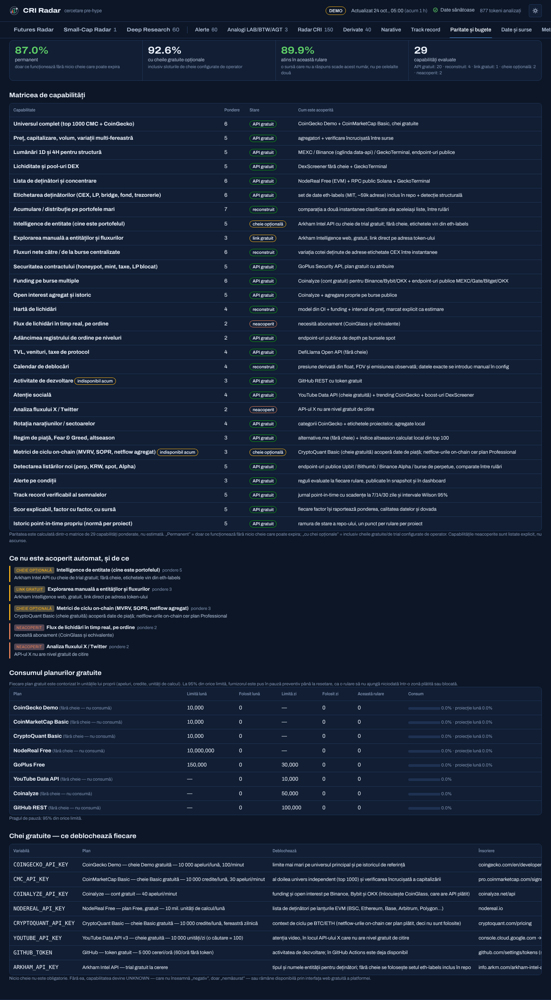
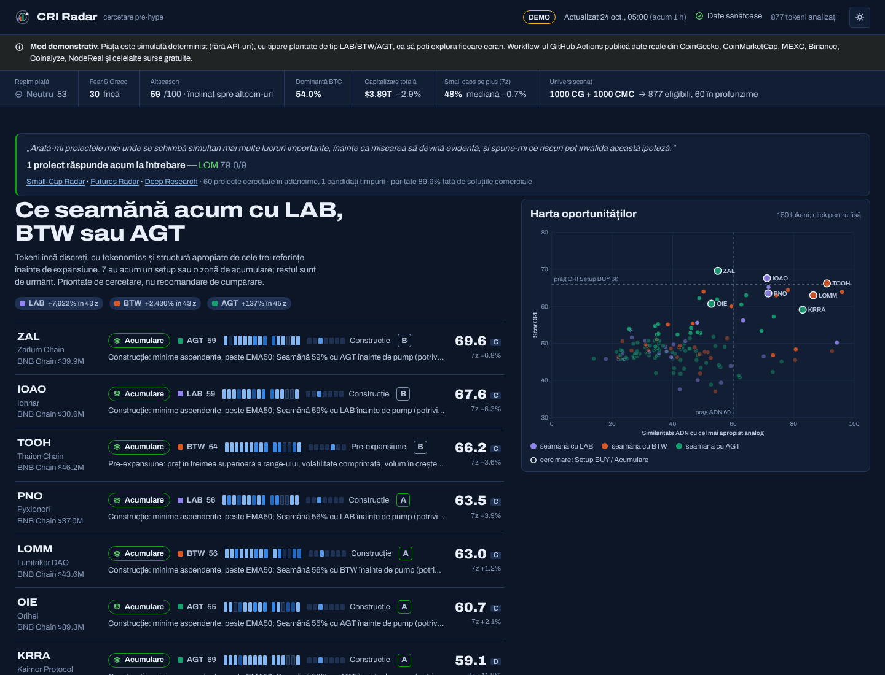
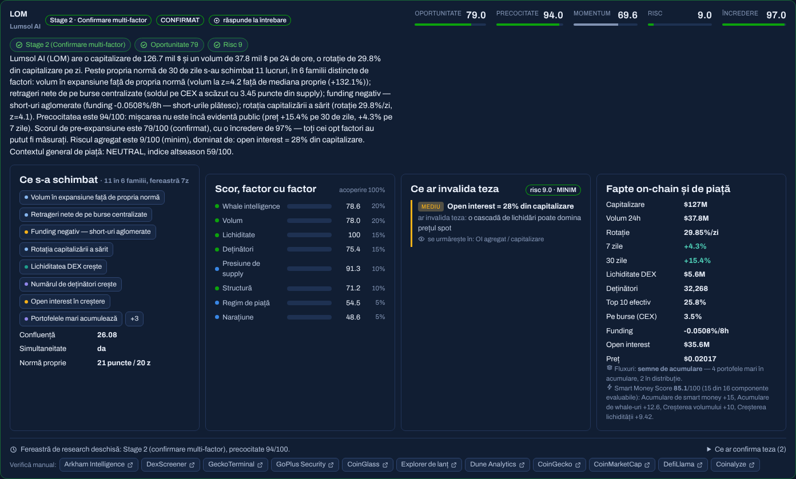
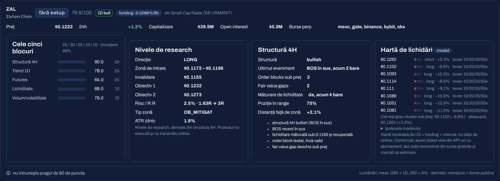
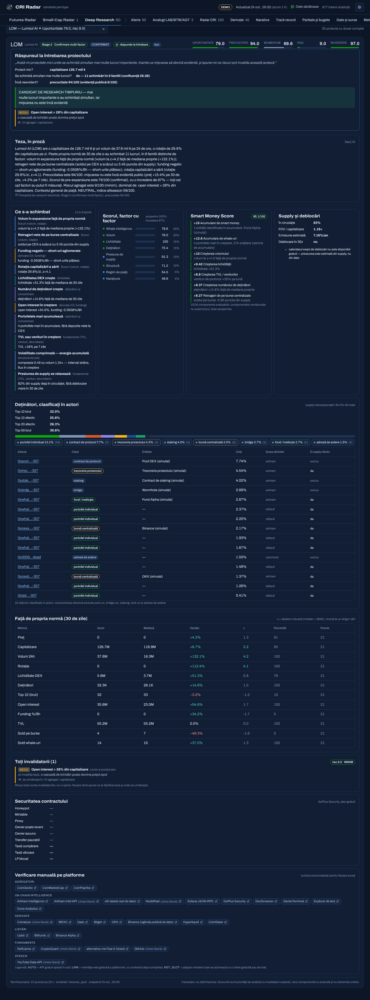
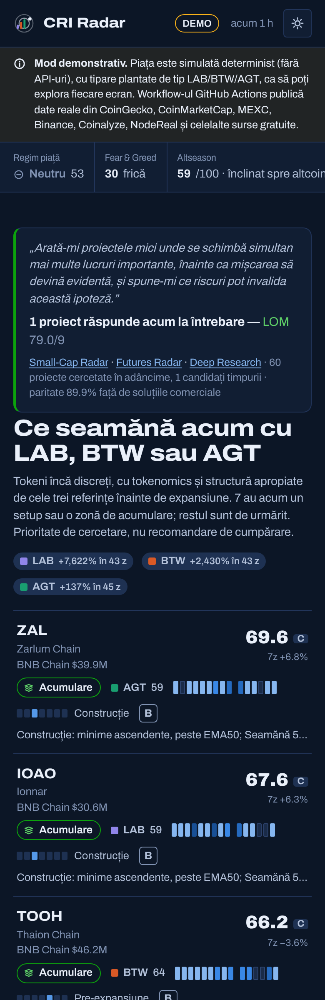

# CRI Radar

**Crypto Research Intelligence** — un motor de cercetare care scanează top 1000 CoinMarketCap și
CoinGecko și răspunde la o singură întrebare, formulată cuvânt cu cuvânt:

> „Arată-mi proiectele mici unde se schimbă simultan mai multe lucruri importante, înainte ca
> mișcarea să devină evidentă, și spune-mi ce riscuri pot invalida această ipoteză.”

Node.js, arhitectură hexagonală, **zero dependențe la rulare**, **niciun abonament de niciun fel**.
Rulează pe GitHub Actions și publică un dashboard static pe GitHub Pages.

Este un proiect **exclusiv de cercetare**. Nicio componentă nu plasează și nu transmite ordine — un
test de arhitectură respinge automat orice endpoint de execuție sau de retragere.

---

## Ce face, concret

Întrebarea are patru părți, iar fiecare are un motor dedicat.

### „proiectele mici”
Filtru de small-cap din soluția tehnică: capitalizare între **1 și 500 milioane $**, volum de
minimum **500 000 $/zi**. Universul este construit din două surse independente (CoinGecko și
CoinMarketCap, cu CoinPaprika ca plasă de siguranță), fuzionate pe contract și pe nume, nu pe simbol
— ca să nu ajungă doi omonimi în același rând. Stablecoin-urile, activele wrapped/staked și cele
tokenizate sunt excluse explicit, iar fiecare excludere este numărată și publicată.

### „se schimbă simultan mai multe lucruri importante”
Fiecare rulare completă salvează un punct per proiect pe o ramură de stare. Din acel istoric se
construiește **norma proprie a proiectului** (median + MAD pe 30 de zile), iar o schimbare contează
doar dacă depășește acea normă — nu un prag universal. Un token cu volum mereu erratic nu primește un
semnal pentru același salt care ar fi remarcabil pe unul liniștit.

Simultaneitatea cere **lățime**: minimum 3 schimbări importante în minimum 2 **familii distincte** de
factori (fluxuri, deținători, lichiditate, derivate, fundamente, atenție, listări, structură). Cinci
semnale din aceeași familie sunt un singur lucru care se întâmplă, nu cinci.

### „înainte ca mișcarea să devină evidentă”
**Precocitatea** este raportată separat de momentum și nu este niciodată contopită cu el. Cazul LAB
din soluția tehnică este exact motivul: un proiect deja +400 % are momentum 98 și precocitate 35 —
excelent și prea târziu. Evidența publică se măsoară din preț, poziția în interval, trending,
boost-uri plătite și funding aglomerat.

### „ce riscuri pot invalida această ipoteză”
Riscul nu este o notă, ci o **listă de invalidatori numiți**. Fiecare rând spune ce anume ar falsifica
teza și unde se urmărește: honeypot, owner care poate relua controlul, taxă de vânzare, LP neblocat,
deblocare în 30 de zile, float mic, concentrare efectivă, lichiditate subțire, funding periculos,
trezoreria care trimite către burse exact în timpul semnalului. Un invalidator critic duce singur
scorul de risc în banda critică, fiindcă exact asta înseamnă „critic”.

### Verdictul
```
Early Research Candidate = Stage 1–2  ȘI  oportunitate > 75  ȘI  risc < 60
```
Definiția din soluția tehnică, fără condiții adăugate. Un proiect „răspunde la întrebare” când trece
acest test **și** are schimbări simultane în cel puțin două familii.

---

## Pornire rapidă

```bash
git clone <repo> && cd cri-radar
node --version            # ≥ 22.12 (vezi .nvmrc)

npm run demo              # piață simulată determinist → dashboard pe http://localhost:8080
```

`npm run demo` nu atinge niciun API: rulează pe un simulator de piață determinist care conține tipare
plantate de tip LAB/BTW/AGT, ca fiecare ecran să poată fi explorat înainte de prima scanare reală.

Pentru date reale:

```bash
npm run probe             # verifică fiecare sursă gratuită și spune ce funcționează de pe mașina ta
npm run scan              # scanare completă → data/latest.json + stare locală
npm run build && npm run serve
```

| Comandă | Ce face |
|---|---|
| `npm run scan` | scanare completă (univers, venue-uri, deținători, securitate, dezvoltare, atenție) |
| `npm run pulse` | reîmprospătare de 15 minute: preț, funding, open interest — nimic cu cuotă lunară |
| `npm run probe` | o cerere mică per furnizor; raportează stare, latență, chei lipsă și pașii de înscriere |
| `npm run labels` | reconstruiește setul de etichete on-chain din eth-labels (MIT) |
| `npm run demo` | scanare simulată + build + server local |
| `npm run ci` | verificare de sintaxă + 143 de teste (arhitectură, motoare, contract, end-to-end) |
| `npm run summary` | raportul de rulare, așa cum apare în GitHub Actions |

---

## Surse — toate publice sau cu cont gratuit

Nu există niciun abonament în acest proiect. Un **test de arhitectură respinge orice apel către un
host care nu este pe lista de surse aprobate**, și respinge explicit host-urile despre care se știe
că necesită plată. Adăugarea unui furnizor cere adăugarea lui pe listă, în același commit, cu planul
gratuit declarat — exact pasul de review care împiedică un endpoint plătit să se strecoare.

### Fără nicio cheie
CoinPaprika · MEXC spot și futures · oglinda publică de date Binance (`data-api.binance.vision`) ·
Gate · Bitget · OKX · Hyperliquid · Upbit · Bithumb · Binance Alpha · DexScreener · GeckoTerminal ·
RPC public Solana · DefiLlama Open API · alternative.me Fear & Greed · setul de etichete
[eth-labels](https://github.com/dawsbot/eth-labels) (MIT, 61 108 adrese, inclus în repository)

### Cu o cheie gratuită, opțională
| Variabilă | Plan | Ce deblochează |
|---|---|---|
| `COINGECKO_API_KEY` | Demo, 10 000 apeluri/lună | limite mai mari pe universul principal |
| `CMC_API_KEY` | Basic, 10 000 credite/lună | al doilea univers independent + verificare încrucișată |
| `COINALYZE_API_KEY` | cont gratuit, 40 apeluri/minut | funding și open interest pe Binance, Bybit, OKX |
| `NODEREAL_API_KEY` | Free, 10 mil. unități/lună | lista de deținători pe lanțurile EVM |
| `CRYPTOQUANT_API_KEY` | Basic, 10 000 credite/lună | context de ciclu pe BTC/ETH |
| `YOUTUBE_API_KEY` | gratuit, 10 000 unități/zi | atenție video (API-ul X nu are nivel gratuit de citire) |
| `GITHUB_TOKEN` | gratuit, 5 000 cereri/oră | activitate de dezvoltare (în Actions există deja) |
| `ARKHAM_API_KEY` | trial gratuit, la cerere | tipul și numele entității pentru deținători |

**Nicio cheie nu este obligatorie.** Fără ea, capabilitatea devine `UNKNOWN` — ceea ce nu înseamnă
„negativ”, ci „nemăsurat” — sau rămâne disponibilă prin interfața web gratuită a platformei.

### Platformele cu API plătit, păstrate ca link gratuit
**CoinGlass**, **Dune Analytics**, **Arkham Intelligence** (web) și **exploratoarele de lanț** rămân
în proiect ca **linkuri cu context precompletat** pe fiecare proiect: chain, contract, simbol. Așa le
folosește oricum un cercetător. Ce ar fi venit din API-ul lor plătit este fie reconstruit din surse
gratuite și marcat explicit ca model (harta de lichidări), fie listat ca neacoperit.

---

## Paritate cu soluțiile comerciale

Cerința a fost „eficiență comparabilă cu soluțiile comerciale, minimum 90 % din performanța lor”.
Afirmația are sens doar dacă este **calculată**, așa că proiectul publică o matrice de 29 de
capabilități ponderate — ce oferă un birou de research plătit (clasa Nansen / Arkham Pro / CoinGlass
/ Messari) și cum este acoperită aici.

Se raportează **trei cifre, niciodată una**:

| Cifră | Valoare | Ce înseamnă |
|---|---|---|
| **Permanent** | **87,0 %** | doar ce funcționează fără nicio cheie care poate expira |
| **Cu cheile gratuite opționale** | **92,6 %** | inclusiv sloturile de cheie configurate de operator |
| **Atins în rulare** | **89,9 %** | o sursă care nu a răspuns scade această cifră, nu pe celelalte două |

Capabilitățile neacoperite sunt **listate explicit**, nu ascunse: flux de lichidări pe ordine în timp
real (CoinGlass, plătit) și analiza fluxului X (fără nivel gratuit de citire).



---

## Dashboard



Trei secțiuni principale, în ordinea în care lucrează un cercetător, plus un meniu secundar.

**① Futures Radar** — cinci blocuri ponderate: trend 1D (25), structură 4H (30), poziționare pe
derivate (25), lichiditate (10), volum și volatilitate (10). Notele A++ ≥ 95 · A+ ≥ 90 · A ≥ 85 ·
B ≥ 80. Filtrele dure sunt afișate când se aplică: un trend zilnic puternic descendent **exclude
complet** direcția LONG, iar funding extrem, o intrare la peste 8 % deasupra zonei sau un raport
câștig/risc sub 2 **plafonează nota la B** — și se vede ce notă ar fi fost fără plafon.



**② Small-Cap Radar** — răspunsul la întrebare. Fiecare card începe cu testul în trei părți
(Stage · Oportunitate · Risc) și arată care parte a picat, astfel încât o ratare la limită să fie
lizibilă, nu absentă. Urmează ce s-a schimbat, grupat pe familii; scorul factor cu factor, cu
ponderea efectivă și calitatea datelor; invalidatorii; și calea de verificare manuală pe fiecare
platformă.



**③ Deep Research** — un proiect, un singur ecran: teza în proză, deținătorii **clasificați în
actori** (bursă, pool, bridge, staking, trezorerie, fond, adresă semnalată), concentrarea pe
supply-ul efectiv, comparația metrică cu metrică față de propria normă, toți invalidatorii și
registrul complet de platforme.



Meniu secundar: Alerte · Analogi LAB/BTW/AGT · Radar CRI · Derivate · Narative · Track record ·
Paritate și bugete · Date și surse · Metodologie.

Dashboard-ul este mobile-first: fiecare ecran a fost verificat la 390 px fără derulare orizontală.



---

## Cum rămâne onest

- **UNKNOWN nu este bearish.** Un factor nemăsurat este scos din ponderare, ponderea lui se
  redistribuie proporțional, iar încrederea scade. Scorul nu este penalizat, fiindcă „nu am putut
  măsura” și „este rău” sunt lucruri diferite și doar unul dintre ele e în date.
- **Fiecare scor este explicabil**: factor → pondere nominală → pondere efectivă → dovadă → sursă →
  calitatea datelor. Nimic nu apare pe ecran fără provenanță.
- **Concentrarea se calculează pe supply-ul efectiv.** Pool-urile, bridge-urile, staking-ul, lock-urile
  și adresele de ardere sunt excluse din bază, fiindcă nimeni nu poate decide să le vândă.
- **Fără look-ahead.** O normă pentru rularea T folosește doar puncte strict anterioare lui T, iar
  fiecare intrare din track record este înghețată la momentul descoperirii și evaluată mai târziu cu
  prețuri citite ulterior.
- **Un eșantion mic se raportează ca eșantion mic.** Track record-ul vine cu intervale Wilson 95 %;
  sub 20 de intrări rezultatul este marcat explicit ca insuficient, nu prezentat ca rată de succes.
- **Planurile gratuite sunt contorizate** în unitățile lor proprii (apeluri, credite, unități de
  calcul). La 95 % din orice limită publicată, furnizorul intră în pauză preventivă până la resetare,
  ca o rulare să nu ajungă niciodată într-o zonă plătită sau blocată.
- **Harta de lichidări este un model**, nu date de ordine, și spune asta, cu ipotezele alături.

---

## Automatizare

| Workflow | Cadență | Ce face |
|---|---|---|
| `Scan & deploy` | la 4 ore, la :17 | scanare completă, validare contract, salvare stare, deploy Pages |
| `Pulse` | la 15 minute | preț, funding, open interest; nu atinge nicio cuotă lunară |
| `CI` | la fiecare push | sintaxă, reguli de arhitectură, 143 de teste, build DEMO offline |
| `Probe surse` | săptămânal | o cerere per furnizor; eșuează doar dacă o sursă fără cheie a căzut |
| `Actualizare etichete` | lunar | reconstruiește setul eth-labels și deschide un pull request |

Starea de cercetare trăiește pe ramura orfană `cri-state`, un singur commit, force-push la fiecare
rulare, deci nu crește niciodată. Programările GitHub sunt *best effort*: un puls ratat este inofensiv,
fiindcă următorul republică aceleași fapte, iar dashboard-ul își declară mereu propria vechime.

### Pași de configurare
1. **Settings → Pages → Source: GitHub Actions.**
2. Rulează o dată `Scan & deploy` din tab-ul Actions (prima rulare doar înregistrează starea de bază:
   fără istoric propriu nu există încă normă, iar asta se vede în încrederea raportată).
3. Opțional, adaugă oricare dintre cheile gratuite din tabelul de mai sus în **Settings → Secrets and
   variables → Actions**. `npm run probe` îți spune exact care lipsesc și de unde se iau.

> Workflow-urile programate se dezactivează automat după 60 de zile fără activitate în repository.

---

## Structura

```
src/
  domain/          logică pură: zero I/O, zero importuri în afară
    discovery/     norme proprii, ce s-a schimbat, scor de pre-expansiune, stadiu și verdict
    onchain/       clasificarea deținătorilor, fluxuri, Smart Money Score
    futures/       trend 1D, structură 4H, poziționare, hartă de lichidări, notare
    risk/          presiune de supply, motorul de invalidatori
    quality/       faptul măsurat (valoare · sursă · vechime · calitate) și redistribuirea ponderilor
    budget/        registrul de cuote și poarta de pauză la 95 %
    platforms/     modelul în trei straturi al platformelor și sloturile de cheie
    benchmark/     matricea de paritate
    …              narațiune, alerte, backtest, similaritate LAB/BTW/AGT, piață
  application/     cazuri de utilizare + porturi; depinde doar de domeniu
  adapters/        HTTP, furnizori, stare, publicare, fixtures (simulatorul determinist)
  config/          încărcarea configurației și citirea secretelor din mediu
web/               dashboard static, ES module native, fără build step
schema/            contractul backend ↔ dashboard, validat la fiecare publicare
config/labels/     setul de etichete on-chain inclus în repo (MIT)
test/              143 de teste, inclusiv cele de arhitectură
```

Detalii de proiectare, inclusiv de ce fiecare prag este unde este: [docs/ARCHITECTURE.md](docs/ARCHITECTURE.md).

---

## Avertisment

Cercetare, nu sfat financiar. Scorurile sunt priorități de analiză cu invalidatori expliciți, nu
recomandări de cumpărare. Nivelele din Futures Radar sunt derivate din structura prețului și nu sunt
instrucțiuni de tranzacționare. Proiectul nu execută și nu transmite ordine.

MIT. Setul de etichete on-chain este derivat din [eth-labels](https://github.com/dawsbot/eth-labels)
(MIT, notificare în `config/labels/LICENSE-eth-labels.txt`). Date de securitate a contractelor:
GoPlus Security. Fear & Greed Index: alternative.me. Date de derivate: Coinalyze.
